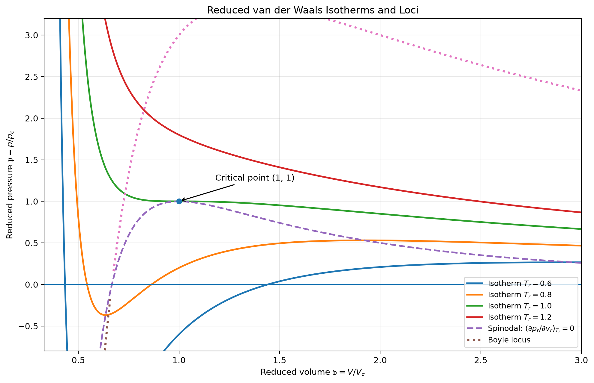

# 演習問題【1-R-8】

## 解答

まず臨界定数を求め，次に対応状態の法則を用いて状態方程式を無次元化し，最後に等温線と2種類の軌跡を導く．

### 1．臨界圧力 $p_c$ ，臨界体積 $V_c$ ，臨界温度 $T_c$ を求める

van der Waals の状態方程式は，

```math
\left(p+\frac{an^2}{V^2}\right)(V-bn)=nRT
```

である．
これを圧力 $p$ について解くと，

```math
p=\frac{nRT}{V-bn}-\frac{an^2}{V^2}
\tag{1}
```

となる．

問題文の注にあるように，臨界点では等温線が極大点と極小点をもつ状態から，単調な曲線へ移行する境界にあたる．
この臨界点では，等温線の接線が水平であり，さらにその点は変曲点でもある．
したがって，臨界点では

```math
\left(\frac{\partial p}{\partial V}\right)_T=0， \qquad \left(\frac{\partial^2p}{\partial V^2}\right)_T=0
\tag{2}
```

が成り立つ．

式 (1) を体積 $V$ で微分すると，

```math
\left(\frac{\partial p}{\partial V}\right)_T =-\frac{nRT}{(V-bn)^2} +\frac{2an^2}{V^3}
```

である．
これを 0 とおくと，

```math
\frac{RT}{(V-bn)^2} =\frac{2an}{V^3}
\tag{3}
```

を得る．

さらに，もう一度 $V$ で微分すると，

```math
\left(\frac{\partial^2p}{\partial V^2}\right)_T =\frac{2nRT}{(V-bn)^3} -\frac{6an^2}{V^4}
```

となる．
これを 0 とおき，両辺を $2n$ で割ると，

```math
\frac{RT}{(V-bn)^3} =\frac{3an}{V^4}
\tag{4}
```

を得る．

式 (3) を式 (4) で割ると，

```math
\frac{(V-bn)^3}{(V-bn)^2} =\frac{2an/V^3}{3an/V^4}
```

となるので，

```math
V-bn=\frac{2}{3}V
```

である．
これを整理すれば，

```math
\boxed{
V_c=3bn
}
```

を得る．

次に，式 (3) に $V_c=3bn$ を代入すると，

```math
\frac{RT_c}{(3bn-bn)^2} =\frac{2an}{(3bn)^3}
```

すなわち，

```math
\frac{RT_c}{4b^2n^2} =\frac{2a}{27b^3n^2}
```

となる．
両辺に $4b^2n^2$ を掛けると，

```math
RT_c=\frac{8a}{27b}
```

であるから，

```math
\boxed{
T_c=\frac{8a}{27Rb}
}
```

を得る．

最後に，式 (1) に $V_c=3bn$ ， $T_c=8a/(27Rb)$ を代入すると，

```math
\begin{aligned}
p_c &=\frac{nR}{3bn-bn}\frac{8a}{27Rb} -\frac{an^2}{(3bn)^2}\\
&=\frac{4a}{27b^2}-\frac{a}{9b^2}\\
&=\frac{a}{27b^2}
\end{aligned}
```

となる．
したがって，臨界定数は

```math
\boxed{
p_c=\frac{a}{27b^2}， \qquad
V_c=3bn， \qquad
T_c=\frac{8a}{27Rb}
}
\tag{5}
```

である．

### 2．対応状態の法則による状態方程式の表現

問題で定義された換算変数を，

```math
\mathfrak p=\frac{p}{p_c}， \qquad
\mathfrak v=\frac{V}{V_c}， \qquad
\mathfrak t=\frac{T}{T_c}
```

とする．
したがって，

```math
p=p_c\mathfrak p， \qquad
V=V_c\mathfrak v， \qquad
T=T_c\mathfrak t
```

である．

これらを式 (1) に代入すると，

```math
p_c\mathfrak p =\frac{nRT_c\mathfrak t}{V_c\mathfrak v-bn} -\frac{an^2}{V_c^2\mathfrak v^2}
```

となる．
ここで式 (5) の臨界定数を用いると，

```math
\frac{a}{27b^2}\mathfrak p = \frac{8a\mathfrak t}{27b^2(3\mathfrak v-1)} -\frac{a}{9b^2\mathfrak v^2}
```

を得る．
両辺に $27b^2/a$ を掛ければ，

```math
\boxed{
\mathfrak p =\frac{8\mathfrak t}{3\mathfrak v-1} -\frac{3}{\mathfrak v^2}
}
\tag{6}
```

となる．
同じ式を整理すると，

```math
\boxed{
\left(\mathfrak p+\frac{3}{\mathfrak v^2}\right) (3\mathfrak v-1)=8\mathfrak t
}
```

とも書ける．

この換算状態方程式には，物質ごとに異なる定数 $a,b$ が含まれていない．
したがって，van der Waals の状態方程式に従う気体は，換算圧力・換算体積・換算温度が等しければ，共通の状態方程式で表される．
これを対応状態の法則という．

なお，式 (6) が定義される範囲は，

```math
\boxed{
\mathfrak v>\frac{1}{3}
}
```

である．
これは元の状態方程式の分母 $V-bn$ が正でなければならないことに対応する．

### 3．等温線と $\left(\partial\mathfrak p/\partial\mathfrak v\right)_{\mathfrak t}=0$ の軌跡

式 (6) において，換算温度 $\mathfrak t$ を一定にすれば， $\mathfrak p$ は $\mathfrak v$ の関数として表される．
これが換算圧力・換算体積平面における等温線である．

まず，式 (6) を $\mathfrak v$ で偏微分すると，

```math
\left(\frac{\partial\mathfrak p} {\partial\mathfrak v}\right)_{\mathfrak t} =-\frac{24\mathfrak t}{(3\mathfrak v-1)^2} +\frac{6}{\mathfrak v^3}
```

となる．
極大点・極小点では接線が水平になるため，

```math
\left(\frac{\partial\mathfrak p} {\partial\mathfrak v}\right)_{\mathfrak t}=0
```

である．
したがって，

```math
-\frac{24\mathfrak t}{(3\mathfrak v-1)^2} +\frac{6}{\mathfrak v^3}=0
```

を整理すると，

```math
\boxed{
4\mathfrak t =\frac{(3\mathfrak v-1)^2}{\mathfrak v^3}
}
\tag{7}
```

を得る．

この式を式 (6) に代入して $\mathfrak t$ を消去する．
式 (7) より，

```math
8\mathfrak t =\frac{2(3\mathfrak v-1)^2}{\mathfrak v^3}
```

であるため，

```math
\begin{aligned}
\mathfrak p &=\frac{2(3\mathfrak v-1)}{\mathfrak v^3} -\frac{3}{\mathfrak v^2}\\
&=\frac{6\mathfrak v-2-3\mathfrak v} {\mathfrak v^3}
\end{aligned}
```

となる．
よって，

```math
\boxed{
\mathfrak p =\frac{3\mathfrak v-2}{\mathfrak v^3}
}
\tag{8}
```

を得る．
これが，

```math
\left(\frac{\partial\mathfrak p} {\partial\mathfrak v}\right)_{\mathfrak t}=0
```

となる点の軌跡である．
この軌跡は，等温線の極大点と極小点を結ぶ曲線であり，スピノーダル曲線と呼ばれる．

式 (7) を見ると， $\mathfrak v>1/3$ の範囲で，

```math
\mathfrak t =\frac{(3\mathfrak v-1)^2}{4\mathfrak v^3}
```

は $\mathfrak v=1$ で最大値 $1$ をとる．
したがって，等温線の形状は次のように分類される．

- $0<\mathfrak t<1$ では，等温線は極小点と極大点をそれぞれ1つもつ．
- $\mathfrak t=1$ では，両方の極値点が臨界点 $(\mathfrak v,\mathfrak p)=(1,1)$ に一致し，水平な接線をもつ変曲点となる．
- $\mathfrak t>1$ では，極大点・極小点が存在せず，等温線は単調減少する．

臨界点が式 (8) の軌跡上にあることも確かめられる．
実際， $\mathfrak v=1$ とすると，

```math
\mathfrak p=\frac{3-2}{1^3}=1
```

となる．

### 4．Boyle 曲線の軌跡を求める

次に，問題で指定された条件

```math
\left( \frac{\partial(\mathfrak p\mathfrak v)} {\partial\mathfrak p} \right)_{\mathfrak t}=0
```

を考える．
ここでは，偏微分する変数が $\mathfrak p$ であることに注意する．

式 (6) より，

```math
\mathfrak p\mathfrak v =\frac{8\mathfrak t\mathfrak v}{3\mathfrak v-1} -\frac{3}{\mathfrak v}
```

となる．
一定の $\mathfrak t$ のもとで $\mathfrak p$ と $\mathfrak v$ は関係しているため，連鎖律を用いれば，

```math
\left( \frac{\partial(\mathfrak p\mathfrak v)} {\partial\mathfrak p} \right)_{\mathfrak t} = \frac{ \left(\frac{\partial(\mathfrak p\mathfrak v)} {\partial\mathfrak v}\right)_{\mathfrak t} }{ \left(\frac{\partial\mathfrak p} {\partial\mathfrak v}\right)_{\mathfrak t} }
```

と表せる．
ただし，この商の形を使うには，分母が 0 でないことが必要である．

まず，分子を計算すると，

```math
\begin{aligned}
\left( \frac{\partial(\mathfrak p\mathfrak v)} {\partial\mathfrak v} \right)_{\mathfrak t} &=-\frac{8\mathfrak t}{(3\mathfrak v-1)^2} +\frac{3}{\mathfrak v^2}
\end{aligned}
```

となる．
したがって，通常の点で条件が成り立つためには，

```math
-\frac{8\mathfrak t}{(3\mathfrak v-1)^2} +\frac{3}{\mathfrak v^2}=0
```

でなければならない．
これを整理すると，

```math
\boxed{
8\mathfrak t =\frac{3(3\mathfrak v-1)^2}{\mathfrak v^2}
}
\tag{9}
```

を得る．

式 (9) を式 (6) に代入すると，

```math
\begin{aligned}
\mathfrak p &=\frac{3(3\mathfrak v-1)}{\mathfrak v^2} -\frac{3}{\mathfrak v^2}\\
&=\frac{9\mathfrak v-6}{\mathfrak v^2}
\end{aligned}
```

となる．
よって，

```math
\boxed{
\mathfrak p =\frac{3(3\mathfrak v-2)}{\mathfrak v^2}
}
\tag{10}
```

を得る．
これが Boyle 曲線の軌跡の方程式である．

ただし，式 (9) を式 (6) に代入しただけでは，元の微分条件を満たさない点が含まれる可能性がある．
実際，式 (9) を満たす点では，

```math
\left( \frac{\partial\mathfrak p} {\partial\mathfrak v} \right)_{\mathfrak t} =-\frac{3(3\mathfrak v-2)}{\mathfrak v^3}
```

となるため， $\mathfrak v=2/3$ では分母が 0 になり，先ほどの連鎖律の商の形が使えない．
この点では元の微分条件を満たさないため，厳密には Boyle 曲線から除外する．

したがって，問題で与えられた微分条件に厳密に従う Boyle 曲線は，式 (10) の曲線から $(\mathfrak v,\mathfrak p)=(2/3,0)$ を除いたものとなる．
なお， $\left(\partial(\mathfrak p\mathfrak v)/\partial\mathfrak v\right)_{\mathfrak t}=0$ という条件で定義する場合には，この点も式 (10) の曲線に含まれる．

### 5．等温線と軌跡のグラフ

以上の結果をまとめると，換算状態方程式，スピノーダル曲線，Boyle 曲線はそれぞれ，

```math
\boxed{
\mathfrak p =\frac{8\mathfrak t}{3\mathfrak v-1} -\frac{3}{\mathfrak v^2}
}
```

```math
\boxed{
\mathfrak p=\frac{3\mathfrak v-2}{\mathfrak v^3}
}
```

```math
\boxed{
\mathfrak p=\frac{3(3\mathfrak v-2)}{\mathfrak v^2}
}
```

で与えられる．
これらを用いて， $\mathfrak p$-$\mathfrak v$ 平面に描いたグラフを以下に示す．

換算温度 $\mathfrak t=0.6,\,0.8,\,1,\,1.2$ の等温線と，各軌跡を示す．
破線は $(\partial\mathfrak p/\partial\mathfrak v)_{\mathfrak t}=0$ の軌跡，点線は Boyle 曲線である．



計算式を直接プロットしたグラフは，こちらから確認できる．

換算状態の等温線と2つの軌跡のグラフを開く

グラフでは，臨界等温線 $\mathfrak t=1$ が $(1,1)$ で水平な変曲点をもち，低温の等温線は極大点と極小点をもつ一方，高温の等温線は単調減少している．
また，スピノーダル曲線は各等温線の極大点・極小点を結んでいる．

なお，グラフには数式の挙動を示すため， $\mathfrak p<0$ の数学的な部分も含めている．
実際の気液平衡を考える場合には，負圧の部分や不安定な枝を，安定な熱平衡状態の等温線としてそのまま採用することはできない．

以上により，臨界定数，対応状態の法則による状態方程式，等温線の極値点の軌跡および Boyle 曲線の軌跡が求められた．
