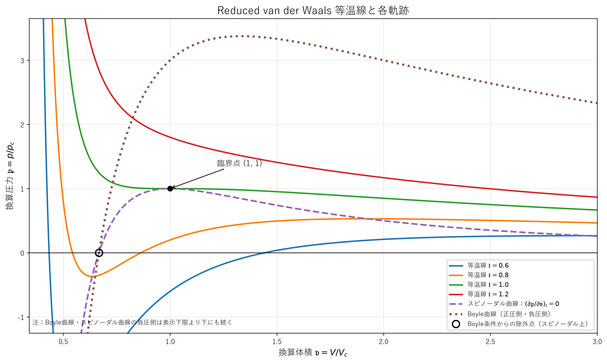

# 例題【1-R-8】

## 解答

### 1．臨界圧力 $p_c$ ，臨界体積 $V_c$ ，臨界温度 $T_c$ を求める

以下では，

```math
n>0,\qquad R>0,\qquad a>0,\qquad b>0
```

を仮定する．
温度は絶対温度とし，物理的な状態方程式の定義域として $T>0$ ， $V>bn$ を考える．

van der Waals の状態方程式は，

```math
\left(p+\frac{an^2}{V^2}\right)(V-bn)
=nRT
```

である．

これを圧力 $p$ について解くと，

```math
\boxed{
p=\frac{nRT}{V-bn}-\frac{an^2}{V^2}
}
\tag{1}
```

となる．

臨界点では，等温線の極大点と極小点が合体する．
したがって，臨界点は等温線の水平な変曲点であり，

```math
\left(\frac{\partial p}{\partial V}\right)_T=0,
\qquad
\left(\frac{\partial^2p}{\partial V^2}\right)_T=0
\tag{2}
```

を満たす．

#### 1.1 臨界体積を求める

式（1）を体積 $V$ で偏微分すると，

```math
\left(\frac{\partial p}{\partial V}\right)_T
=
-\frac{nRT}{(V-bn)^2}
+\frac{2an^2}{V^3}
```

となる．

これをゼロとおくと，

```math
-\frac{nRT}{(V-bn)^2}
+\frac{2an^2}{V^3}=0
```

より，

```math
\frac{RT}{(V-bn)^2}
=
\frac{2an}{V^3}
\tag{3}
```

を得る．

さらに，もう一度体積 $V$ で偏微分すると，

```math
\left(\frac{\partial^2p}{\partial V^2}\right)_T
=
\frac{2nRT}{(V-bn)^3}
-\frac{6an^2}{V^4}
```

となる．

これをゼロとおき，両辺を $2n$ で割ると，

```math
\frac{RT}{(V-bn)^3}
=
\frac{3an}{V^4}
\tag{4}
```

を得る．

式（3）を式（4）で割ると，

```math
\frac{RT/(V-bn)^2}
{RT/(V-bn)^3}
=
\frac{2an/V^3}{3an/V^4}
```

となる．

したがって，

```math
V-bn=\frac23V
```

である．

これを整理すると，

```math
V=3bn
```

となる．

よって，臨界体積は，

```math
\boxed{V_c=3bn}
\tag{5}
```

である．

#### 1.2 臨界温度を求める

式（3）に $V_c=3bn$ を代入すると，

```math
\frac{RT_c}{(3bn-bn)^2}
=
\frac{2an}{(3bn)^3}
```

すなわち，

```math
\frac{RT_c}{4b^2n^2}
=
\frac{2a}{27b^3n^2}
```

となる．

両辺に $4b^2n^2$ を掛けると，

```math
RT_c=\frac{8a}{27b}
```

であるから，

```math
\boxed{
T_c=\frac{8a}{27Rb}
}
\tag{6}
```

を得る．

#### 1.3 臨界圧力を求める

式（1）に，

```math
V_c=3bn,\qquad
T_c=\frac{8a}{27Rb}
```

を代入すると，

```math
\begin{aligned}
p_c
&=
\frac{nR}{3bn-bn}\frac{8a}{27Rb}
-\frac{an^2}{(3bn)^2}\\
&=
\frac{4a}{27b^2}
-\frac{a}{9b^2}\\
&=
\frac{a}{27b^2}
\end{aligned}
```

となる．

したがって，臨界定数は，

```math
\boxed{
p_c=\frac{a}{27b^2},\qquad
V_c=3bn,\qquad
T_c=\frac{8a}{27Rb}
}
\tag{7}
```

である．

#### 1.4 臨界点が水平な接線を持つ変曲点であることの確認

臨界点が真正の変曲点であることを確認するため，3階微分を調べる．

式（1）をさらに微分すると，

```math
\left(\frac{\partial^3p}{\partial V^3}\right)_T
=
-\frac{6nRT}{(V-bn)^4}
+\frac{24an^2}{V^5}
```

となる．

臨界定数を代入すると，

```math
\begin{aligned}
\left.
\left(\frac{\partial^3p}{\partial V^3}\right)_T
\right|_c
&=
-\frac{6nRT_c}{(2bn)^4}
+\frac{24an^2}{(3bn)^5}\\
&=
-\frac{a}{9b^5n^3}
+\frac{8a}{81b^5n^3}\\
&=
-\frac{a}{81b^5n^3}
\end{aligned}
```

となる．

$a>0$ ， $b>0$ ， $n>0$ より，

```math
\boxed{
\left.
\left(\frac{\partial^3p}{\partial V^3}\right)_T
\right|_c<0
}
```

である．

したがって，

```math
p'_c=0,\qquad
p''_c=0,\qquad
p'''_c\ne0
```

が成立する．

よって，臨界点は水平な接線を持つ真正の変曲点である．

### 2．対応状態の法則による状態方程式の表現

問題で定義された換算変数を，

```math
\mathfrak p=\frac{p}{p_c},\qquad
\mathfrak v=\frac{V}{V_c},\qquad
\mathfrak t=\frac{T}{T_c}
```

とする．

したがって，

```math
p=p_c\mathfrak p,\qquad
V=V_c\mathfrak v,\qquad
T=T_c\mathfrak t
```

である．

これらを式（1）に代入すると，

```math
p_c\mathfrak p
=
\frac{nRT_c\mathfrak t}
{V_c\mathfrak v-bn}
-\frac{an^2}{V_c^2\mathfrak v^2}
```

となる．

ここで，式（7）の臨界定数を用いると，

```math
\frac{a}{27b^2}\mathfrak p
=
\frac{8a\mathfrak t}
{27b^2(3\mathfrak v-1)}
-\frac{a}{9b^2\mathfrak v^2}
```

を得る．

両辺に $27b^2/a$ を掛ければ，

```math
\boxed{
\mathfrak p
=
\frac{8\mathfrak t}{3\mathfrak v-1}
-\frac{3}{\mathfrak v^2}
}
\tag{8}
```

となる．

同じ式は，

```math
\boxed{
\left(\mathfrak p+\frac{3}{\mathfrak v^2}\right)
(3\mathfrak v-1)=8\mathfrak t
}
```

とも書ける．

この換算状態方程式には，物質ごとに異なる定数 $a,b$ が含まれていない．

したがって，van der Waals の状態方程式に従う気体は，換算圧力，換算体積，換算温度が等しければ，共通の状態方程式で表される．

これを対応状態の法則という．

#### 2.1 物理的な体積領域

van der Waals 気体では，状態方程式の定義域として，

```math
V>bn
```

を考える．

したがって，

```math
\boxed{\mathfrak v>\frac13}
\tag{9}
```

となる．

これは排除体積による体積の制約である．

ただし，この条件は圧力が正であることを意味しない．
実際，式（8）は，この体積領域内でも負の換算圧力を与えることがある．

以下では，状態方程式の定義域である $\mathfrak v>1/3$ を対象とする．
負圧となる部分も，明示的に数学的な状態方程式の延長として扱う．

### 3．等温線と $(\partial\mathfrak p/\partial\mathfrak v)_{\mathfrak t}=0$ の軌跡

式（8）において，換算温度 $\mathfrak t$ を一定にすれば，換算圧力 $\mathfrak p$ は換算体積 $\mathfrak v$ の関数となる．

これが $\mathfrak p-\mathfrak v$ 平面における等温線である．

#### 3.1 等温線の極値条件

式（8）を $\mathfrak v$ で偏微分すると，

```math
\left(
\frac{\partial\mathfrak p}
{\partial\mathfrak v}
\right)_{\mathfrak t}
=
-\frac{24\mathfrak t}{(3\mathfrak v-1)^2}
+\frac{6}{\mathfrak v^3}
\tag{10}
```

となる．

等温線の極大点・極小点では接線が水平になるため，

```math
\left(
\frac{\partial\mathfrak p}
{\partial\mathfrak v}
\right)_{\mathfrak t}=0
```

である．

したがって，

```math
-\frac{24\mathfrak t}{(3\mathfrak v-1)^2}
+\frac{6}{\mathfrak v^3}=0
```

を整理すると，

```math
\boxed{
\mathfrak t
=
\frac{(3\mathfrak v-1)^2}
{4\mathfrak v^3}
}
\tag{11}
```

を得る．

この式を式（8）に代入して $\mathfrak t$ を消去する．

式（11）より，

```math
8\mathfrak t
=
\frac{2(3\mathfrak v-1)^2}
{\mathfrak v^3}
```

であるため，

```math
\begin{aligned}
\mathfrak p
&=
\frac{2(3\mathfrak v-1)}{\mathfrak v^3}
-\frac{3}{\mathfrak v^2}\\
&=
\frac{6\mathfrak v-2-3\mathfrak v}
{\mathfrak v^3}
\end{aligned}
```

となる．

よって，

```math
\boxed{
\mathfrak p
=
\frac{3\mathfrak v-2}{\mathfrak v^3}
}
\tag{12}
```

を得る．

式（11），式（12）が，

```math
\left(
\frac{\partial\mathfrak p}
{\partial\mathfrak v}
\right)_{\mathfrak t}=0
```

となる点の軌跡である．

この軌跡をスピノーダル曲線という．

#### 3.2 等温線の形状の分類

スピノーダル曲線上の換算温度は，

```math
\mathfrak t_s(\mathfrak v)
=
\frac{(3\mathfrak v-1)^2}
{4\mathfrak v^3}
```

である．

これを微分すると，

```math
\frac{d\mathfrak t_s}{d\mathfrak v}
=
\frac{3(3\mathfrak v-1)(1-\mathfrak v)}
{4\mathfrak v^4}
```

となる．

定義域 $\mathfrak v>1/3$ では，

```math
\lim_{\mathfrak v\to1/3+}\mathfrak t_s=0,
\qquad
\lim_{\mathfrak v\to\infty}\mathfrak t_s=0
```

である．

また，導関数は，

```math
\frac13<\mathfrak v<1
```

では正，

```math
\mathfrak v>1
```

では負となる．

したがって， $\mathfrak v=1$ で最大値をとり，

```math
\mathfrak t_s(1)=1
```

である．

さらに，式（10）は，

```math
\left(
\frac{\partial\mathfrak p}
{\partial\mathfrak v}
\right)_{\mathfrak t}
=
\frac{24}{(3\mathfrak v-1)^2}
\left(\mathfrak t_s(\mathfrak v)-\mathfrak t\right)
```

と書ける．

この式と $\mathfrak t_s$ の形状から，等温線は次のように分類される．

- $0<\mathfrak t<1$ では，等温線は極小点と極大点をそれぞれ1つ持つ．
- $\mathfrak t=1$ では，両方の極値点が臨界点 $(\mathfrak v,\mathfrak p)=(1,1)$ に一致する．
- $\mathfrak t>1$ では，極大点・極小点が存在せず，等温線は単調減少する．

臨界点が水平な接線を持つ変曲点であることは，換算状態方程式の高階微分からも確認できる．

2階微分は，

```math
\left(
\frac{\partial^2\mathfrak p}
{\partial\mathfrak v^2}
\right)_{\mathfrak t}
=
\frac{144\mathfrak t}{(3\mathfrak v-1)^3}
-\frac{18}{\mathfrak v^4}
```

である．

3階微分は，

```math
\left(
\frac{\partial^3\mathfrak p}
{\partial\mathfrak v^3}
\right)_{\mathfrak t}
=
-\frac{1296\mathfrak t}{(3\mathfrak v-1)^4}
+\frac{72}{\mathfrak v^5}
```

となる．

臨界点 $(\mathfrak v,\mathfrak t)=(1,1)$ では，

```math
\left(
\frac{\partial\mathfrak p}
{\partial\mathfrak v}
\right)_{\mathfrak t}=0
```

および，

```math
\left(
\frac{\partial^2\mathfrak p}
{\partial\mathfrak v^2}
\right)_{\mathfrak t}=0
```

である一方，

```math
\boxed{
\left(
\frac{\partial^3\mathfrak p}
{\partial\mathfrak v^3}
\right)_{\mathfrak t}
=-9\ne0
}
```

である．

よって，臨界点は水平な接線を持つ真正の変曲点である．

### 4．Boyle 曲線の軌跡を求める

問題で指定された条件は，

```math
\left(
\frac{\partial(\mathfrak p\mathfrak v)}
{\partial\mathfrak p}
\right)_{\mathfrak t}=0
\tag{13}
```

である．

ここでは換算温度 $\mathfrak t$ を一定に保ち，換算圧力 $\mathfrak p$ を独立変数として微分する．

#### 4.1 連鎖律による変形

式（8）より，

```math
\mathfrak p\mathfrak v
=
\frac{8\mathfrak t\mathfrak v}
{3\mathfrak v-1}
-\frac{3}{\mathfrak v}
\tag{14}
```

である．

一定の $\mathfrak t$ のもとで， $\mathfrak p$ は $\mathfrak v$ の関数である．

ただし，

```math
\left(
\frac{\partial\mathfrak p}
{\partial\mathfrak v}
\right)_{\mathfrak t}\ne0
```

となる点では，逆関数定理により局所的に $\mathfrak v$ を $\mathfrak p$ の微分可能な関数として表せる．

したがって，この条件のもとで連鎖律を用いると，

```math
\boxed{
\left(
\frac{\partial(\mathfrak p\mathfrak v)}
{\partial\mathfrak p}
\right)_{\mathfrak t}
=
\frac{
\left(
\frac{\partial(\mathfrak p\mathfrak v)}
{\partial\mathfrak v}
\right)_{\mathfrak t}
}{
\left(
\frac{\partial\mathfrak p}
{\partial\mathfrak v}
\right)_{\mathfrak t}
}
}
\tag{15}
```

となる．

まず，分子を計算する．

```math
\begin{aligned}
\left(
\frac{\partial(\mathfrak p\mathfrak v)}
{\partial\mathfrak v}
\right)_{\mathfrak t}
&=
\frac{\partial}{\partial\mathfrak v}
\left(
\frac{8\mathfrak t\mathfrak v}
{3\mathfrak v-1}
-\frac{3}{\mathfrak v}
\right)\\
&=
-\frac{8\mathfrak t}{(3\mathfrak v-1)^2}
+\frac{3}{\mathfrak v^2}
\end{aligned}
\tag{16}
```

となる．

#### 4.2 Boyle 曲線の候補軌跡

式（15）の分母がゼロでない点では，指定された偏微分がゼロになるための条件は，式（16）の分子がゼロになることである．

したがって，

```math
-\frac{8\mathfrak t}{(3\mathfrak v-1)^2}
+\frac{3}{\mathfrak v^2}=0
```

を解くと，

```math
\boxed{
\mathfrak t
=
\frac{3(3\mathfrak v-1)^2}
{8\mathfrak v^2}
}
\tag{17}
```

を得る．

これを式（8）に代入すると，

```math
\begin{aligned}
\mathfrak p
&=
\frac{3(3\mathfrak v-1)}
{\mathfrak v^2}
-\frac{3}{\mathfrak v^2}\\
&=
\frac{9\mathfrak v-6}{\mathfrak v^2}
\end{aligned}
```

となる．

よって，

```math
\boxed{
\mathfrak p
=
\frac{3(3\mathfrak v-2)}
{\mathfrak v^2}
}
\tag{18}
```

を得る．

ただし，式（15）の分母がゼロとなる点では連鎖律の商をそのまま適用できない．

したがって，式（17），式（18）から得られた曲線上に，元の偏微分条件を満たさない点が含まれていないかを別途調べる必要がある．

#### 4.3 連鎖律の分母がゼロとなる点の検証

式（10）より，

```math
\left(
\frac{\partial\mathfrak p}
{\partial\mathfrak v}
\right)_{\mathfrak t}
=
-\frac{24\mathfrak t}{(3\mathfrak v-1)^2}
+\frac{6}{\mathfrak v^3}
```

である．

式（17）を満たす点では，

```math
\begin{aligned}
\left(
\frac{\partial\mathfrak p}
{\partial\mathfrak v}
\right)_{\mathfrak t}
&=
-\frac{9}{\mathfrak v^2}
+\frac{6}{\mathfrak v^3}\\
&=
-\frac{3(3\mathfrak v-2)}
{\mathfrak v^3}
\end{aligned}
\tag{19}
```

となる．

したがって，

```math
\left(
\frac{\partial\mathfrak p}
{\partial\mathfrak v}
\right)_{\mathfrak t}=0
```

となるのは，

```math
\mathfrak v=\frac23
```

の場合である．

式（17）に代入すると，

```math
\begin{aligned}
\mathfrak t_0
&=
\frac{
3\left(3\cdot\frac23-1\right)^2
}{
8\left(\frac23\right)^2
}\\
&=
\frac{27}{32}
\end{aligned}
```

となる．

また，式（18）より，

```math
\mathfrak p_0
=
\frac{
3\left(3\cdot\frac23-2\right)
}{
(2/3)^2
}
=0
```

である．

したがって，特異点は，

```math
\boxed{
(\mathfrak v_0,\mathfrak p_0,\mathfrak t_0)
=
\left(\frac23,0,\frac{27}{32}\right)
}
\tag{20}
```

である．

この点では，式（15）の分母がゼロになるため，連鎖律の商をそのまま適用することはできない．

そこで，この点における偏微分の存在性を直接調べる．

#### 4.4 特異点における偏微分の検証

温度を，

```math
\mathfrak t=\mathfrak t_0=\frac{27}{32}
```

に固定して，状態方程式に代入する．

すると，

```math
\begin{aligned}
\mathfrak p(\mathfrak v,\mathfrak t_0)
&=
\frac{27}{4(3\mathfrak v-1)}
-\frac{3}{\mathfrak v^2}\\
&=
\frac{
27\left(\mathfrak v-\frac23\right)^2
}{
4\mathfrak v^2(3\mathfrak v-1)
}
\end{aligned}
\tag{21}
```

となる．

したがって， $\mathfrak v>1/3$ において，

```math
\mathfrak p(\mathfrak v,\mathfrak t_0)\geq0
```

であり，

```math
\mathfrak v=\frac23
```

でのみゼロとなる．

つまり，この温度の等温線では，圧力は $\mathfrak v=2/3$ で局所最小値ゼロを取る．

ここで，

```math
q(\mathfrak v)
=
\mathfrak p(\mathfrak v,\mathfrak t_0)\mathfrak v
```

とおく．

特異点では，

```math
\mathfrak p(\mathfrak v_0,\mathfrak t_0)=0,
\qquad
q(\mathfrak v_0)=0
```

である．

また， $\mathfrak v\ne\mathfrak v_0$ では式（21）より圧力は正であるため，

```math
\begin{aligned}
\frac{
q(\mathfrak v)-q(\mathfrak v_0)
}{
\mathfrak p(\mathfrak v,\mathfrak t_0)
-\mathfrak p(\mathfrak v_0,\mathfrak t_0)
}
&=
\frac{
\mathfrak p(\mathfrak v,\mathfrak t_0)\mathfrak v
}{
\mathfrak p(\mathfrak v,\mathfrak t_0)
}\\
&=\mathfrak v
\end{aligned}
```

となる．

よって，

```math
\boxed{
\lim_{\mathfrak v\to2/3}
\frac{
q(\mathfrak v)-q(2/3)
}{
\mathfrak p(\mathfrak v,\mathfrak t_0)
-\mathfrak p(2/3,\mathfrak t_0)
}
=
\frac23
}
\tag{22}
```

を得る．

この極限は，各体積枝に沿った片側微分に対応する．

実際，式（21）から，特異点の近傍では圧力はゼロ以上であり，正圧は特異点の両側の体積枝に対応する．

したがって，この特異点の近傍では，圧力を体積の一価関数として表すことはできるが，両側の体積枝を同時に含めて体積を圧力の一価関数として表すことはできない．

そのため，特異点では通常の両側偏微分を定義できない．

一方，各枝に沿った片側微分は存在し，その値はいずれも，

```math
\boxed{
\lim_{\mathfrak p\to0+}
\left(
\frac{\partial(\mathfrak p\mathfrak v)}
{\partial\mathfrak p}
\right)_{\mathfrak t_0,\ \mathrm{branch}}
=
\frac23\ne0
}
\tag{23}
```

である．

したがって，この点は，通常の両側偏微分の意味では定義域に含まれず，各枝に沿った片側微分の意味でも指定された微分条件がゼロになる点ではない．

なお，一般に，

```math
\left(
\frac{\partial\mathfrak p}
{\partial\mathfrak v}
\right)_{\mathfrak t}=0
```

となる点では，連鎖律の商は直接使用できない．

そのような点で $\mathfrak p\ne0$ であれば，

```math
\begin{aligned}
\left(
\frac{\partial(\mathfrak p\mathfrak v)}
{\partial\mathfrak v}
\right)_{\mathfrak t}
&=
\mathfrak p+
\mathfrak v
\left(
\frac{\partial\mathfrak p}
{\partial\mathfrak v}
\right)_{\mathfrak t}\\
&=\mathfrak p\ne0
\end{aligned}
```

となる．

したがって，圧力を独立変数とした微分は有限なゼロにはならない．

また，

```math
\mathfrak p=0
```

かつ圧力の体積微分もゼロとなる点は，上で調べた

```math
\left(\frac23,0,\frac{27}{32}\right)
```

だけであり，そこでも枝ごとの片側微分は $2/3$ である．

以上から，Boyle 曲線の厳密な解集合には，この特異点を含めない．

#### 4.5 Boyle 曲線の厳密な解集合

以上の検討から，指定された偏微分条件を満たす点の集合は，

```math
\boxed{
\begin{aligned}
\mathfrak p
&=
\frac{3(3\mathfrak v-2)}
{\mathfrak v^2},\\[4pt]
\mathfrak t
&=
\frac{3(3\mathfrak v-1)^2}
{8\mathfrak v^2},\\[4pt]
&\mathfrak v>\frac13,\qquad
\mathfrak v\ne\frac23
\end{aligned}
}
\tag{24}
```

で与えられる．

一方，式（17），式（18）から得られる連続的な代数曲線は，

```math
\boxed{
\begin{aligned}
\mathfrak p
&=
\frac{3(3\mathfrak v-2)}
{\mathfrak v^2},\\[4pt]
\mathfrak t
&=
\frac{3(3\mathfrak v-1)^2}
{8\mathfrak v^2},\\[4pt]
&\mathfrak v>\frac13
\end{aligned}
}
\tag{25}
```

である．

式（25）は式（24）の特異点における連続的な代数延長であり，次の点を含む．

```math
(\mathfrak v,\mathfrak p,\mathfrak t)
=
\left(\frac23,0,\frac{27}{32}\right)
```

ただし，この点は元の偏微分条件を満たさない．

したがって，図示の際には，曲線を連続的な代数延長として描き， $(\mathfrak v,\mathfrak p)=(2/3,0)$ に白抜きの丸を付けて，厳密な解集合から除外される特異点として区別する．

また，式（18）から圧力の符号は，

```math
\boxed{
\begin{cases}
\mathfrak p<0,
&\displaystyle \frac13<\mathfrak v<\frac23,\\[6pt]
\mathfrak p>0,
&\displaystyle \mathfrak v>\frac23
\end{cases}
}
```

となる．

したがって，Boyle 曲線の正圧側は $\mathfrak v>2/3$ ，負圧側は $1/3<\mathfrak v<2/3$ である．

さらに，Boyle 曲線上の圧力は，

```math
\mathfrak p_B
=
\frac{3(3\mathfrak v-2)}
{\mathfrak v^2}
```

であるため，

```math
\frac{d\mathfrak p_B}{d\mathfrak v}
=
\frac{3(4-3\mathfrak v)}
{\mathfrak v^3}
```

となる．

したがって，正圧側の極大点は，

```math
\mathfrak v=\frac43
```

にあり，その圧力は，

```math
\boxed{\mathfrak p_B=\frac{27}{8}}
```

である．

### 5．等温線と各軌跡のグラフ

以上の結果をまとめる．

#### 5.1 換算状態方程式

```math
\boxed{
\mathfrak p
=
\frac{8\mathfrak t}{3\mathfrak v-1}
-\frac{3}{\mathfrak v^2}
}
```

#### 5.2 スピノーダル曲線

```math
\boxed{
\begin{aligned}
\mathfrak p
&=\frac{3\mathfrak v-2}{\mathfrak v^3},\\[4pt]
\mathfrak t
&=\frac{(3\mathfrak v-1)^2}{4\mathfrak v^3},\\[4pt]
&\mathfrak v>\frac13
\end{aligned}
}
```

#### 5.3 Boyle 曲線の厳密な解集合

```math
\boxed{
\begin{aligned}
\mathfrak p
&=\frac{3(3\mathfrak v-2)}
{\mathfrak v^2},\\[4pt]
\mathfrak t
&=\frac{3(3\mathfrak v-1)^2}
{8\mathfrak v^2},\\[4pt]
&\mathfrak v>\frac13,\qquad
\mathfrak v\ne\frac23
\end{aligned}
}
```

Boyle 曲線の代数的な延長としては，上式の $\mathfrak v=2/3$ を含む連続曲線を描くことができる．

ただし，厳密な微分条件の解集合では，その点を除外する．

等温線は，

```math
\mathfrak t=0.6,\quad
0.8,\quad
1,\quad
1.2
```

について描く．

スピノーダル曲線は実線，Boyle 曲線の代数的延長は破線で示す．
また，

```math
(\mathfrak v,\mathfrak p)
=
\left(\frac23,0\right)
```

には白抜きの丸を付ける．

この点はスピノーダル曲線上には含まれるが，Boyle 曲線の厳密な微分条件の解集合には含まれない．

なお，グラフでは曲線の発散や表示範囲による見切れを避けるため，表示範囲を限定している．
したがって， $\mathfrak v\to1/3+$ 付近や表示範囲外の圧力については，グラフ上に全体が表示されない場合がある．

### 6．物理的な意味と安定性に関する注意

等温圧縮率は，

```math
\kappa_T
=
-\frac1V
\left(\frac{\partial V}{\partial p}\right)_T
```

で定義される．

局所的に圧力を体積の一価関数として扱え，逆関数が存在する点では，

```math
\kappa_T
=
-\frac1V
\frac{1}{(\partial p/\partial V)_T}
```

である．

したがって，機械的安定性の必要条件は，

```math
\boxed{
\left(\frac{\partial p}{\partial V}\right)_T<0
}
```

である．

逆に，

```math
\left(\frac{\partial p}{\partial V}\right)_T>0
```

となる領域は，等温圧縮率が負となるため，機械的に不安定である．

また，

```math
\left(\frac{\partial p}{\partial V}\right)_T=0
```

となるスピノーダル曲線は，機械的不安定領域と局所的な機械的安定性を持つ領域との境界を表す．
この境界では，等温圧縮率は発散する．

ただし，機械的安定性を満たすことだけで，熱力学的な大域平衡状態であることまで保証されるわけではない．

実際の気液共存状態を求めるには，Maxwell の等面積則などによる熱力学的平衡条件が必要である．

また，負圧であることと機械的不安定であることは同義ではない．
負圧でも機械的に安定な状態は存在し得るため，負圧領域を一律に物理的に不可能な領域とみなしてはならない．

### 7．最終結果

臨界定数は，

```math
\boxed{
p_c=\frac{a}{27b^2},\qquad
V_c=3bn,\qquad
T_c=\frac{8a}{27Rb}
}
```

である．

対応状態の法則による換算状態方程式は，

```math
\boxed{
\mathfrak p
=
\frac{8\mathfrak t}{3\mathfrak v-1}
-\frac{3}{\mathfrak v^2}
}
```

である．

スピノーダル曲線は，

```math
\boxed{
\begin{aligned}
\mathfrak p
&=\frac{3\mathfrak v-2}{\mathfrak v^3},\\
\mathfrak t
&=\frac{(3\mathfrak v-1)^2}{4\mathfrak v^3},\\
&\mathfrak v>\frac13
\end{aligned}
}
```

である．

問題で指定された偏微分条件による Boyle 曲線の厳密な解集合は，

```math
\boxed{
\begin{aligned}
\mathfrak p
&=\frac{3(3\mathfrak v-2)}
{\mathfrak v^2},\\
\mathfrak t
&=\frac{3(3\mathfrak v-1)^2}
{8\mathfrak v^2},\\
&\mathfrak v>\frac13,\qquad
\mathfrak v\ne\frac23
\end{aligned}
}
```

である．

ただし，

```math
\left(\frac23,0,\frac{27}{32}\right)
```

は Boyle 曲線の代数的延長には含まれるが，元の偏微分条件を満たさないため，厳密な解集合から除外する．

以上により，臨界定数，対応状態の法則による状態方程式，スピノーダル曲線，および問題で指定された偏微分条件による Boyle 曲線の厳密な解集合が求められた．


