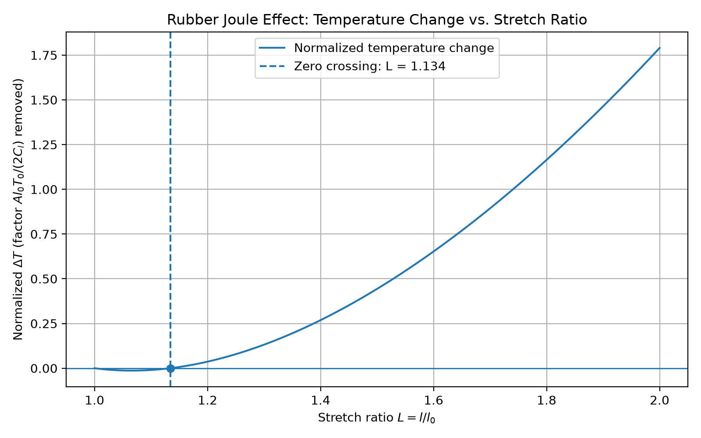

# 演習問題【3-C-34】

## 解答

### 1．断熱伸長時の温度変化率

ゴム糸の長さを $l$ ，全張力を $X$ ，温度を $T$ とする．
温度 $T_0$ での自然長を $l_0$ とし，ゴム糸を自然長から $L$ 倍に伸ばす．
すなわち，

```math
L=\frac{l}{l_0}
```

と定義する．
求める温度変化は $\Delta T=T-T_0$ である．

断熱準静的過程では，熱の出入りがなく，エントロピー $S$ は一定に保たれる．
したがって，

```math
dS=
\left(\frac{\partial S}{\partial T}\right)_l dT
+\left(\frac{\partial S}{\partial l}\right)_T dl=0
```

である．
長さ一定の熱容量を $C_l$ とすると，

```math
C_l=T\left(\frac{\partial S}{\partial T}\right)_l
```

であるから，

```math
\left(\frac{\partial T}{\partial l}\right)_S
=-\frac{T}{C_l}\left(\frac{\partial S}{\partial l}\right)_T
\tag{1}
```

となる．

次に，ヘルムホルツ自由エネルギー $F$ の微分は，

```math
dF=-S\,dT+X\,dl
```

である．
この式から得られるマクスウェルの関係式は，

```math
\left(\frac{\partial S}{\partial l}\right)_T
=-\left(\frac{\partial X}{\partial T}\right)_l
```

である．
これを式 (1) に代入すると，

```math
\boxed{
\left(\frac{\partial T}{\partial l}\right)_S
=\frac{T}{C_l}\left(\frac{\partial X}{\partial T}\right)_l
}
\tag{2}
```

を得る．
これは，断熱的にゴムを伸ばしたときの温度変化率を，実験的に与えられた張力の温度依存性から求める式である．

### 2．与えられた張力の式を代入する

問題で与えられた張力は，

```math
X=AT\left[
\frac{l}{l_0}
-\{1+\alpha(T-T_0)\}
\left(\frac{l_0}{l}\right)^2
\right]
```

である．
$L=l/l_0$ を用いて書き換えると，

```math
X=AT\left[
L-\{1+\alpha(T-T_0)\}L^{-2}
\right]
\tag{3}
```

となる．

ここで，長さ $l$ を一定に保って温度 $T$ で偏微分する．
このとき $L$ は一定であるため，

```math
\begin{aligned}
\left(\frac{\partial X}{\partial T}\right)_l
={}&A\left[L-\{1+\alpha(T-T_0)\}L^{-2}\right]\\
&-\alpha AT L^{-2}
\end{aligned}
```

である．
初期状態の温度 $T=T_0$ では，

```math
\left(\frac{\partial X}{\partial T}\right)_{l,T_0}
=A\left[L-L^{-2}\right]-\alpha AT_0L^{-2}
```

したがって，

```math
\boxed{
\left(\frac{\partial X}{\partial T}\right)_{l,T_0}
=A\left[L-(1+\alpha T_0)L^{-2}\right]
}
\tag{4}
```

となる．

式 (2) に式 (4) を代入し，温度変化が小さいとして，式の右辺にある $T$ を初期温度 $T_0$ で近似する．
また， $C_l$ は伸長過程で一定と仮定する．
すると，

```math
\boxed{
\left(\frac{\partial T}{\partial l}\right)_S
\simeq
\frac{AT_0}{C_l}
\left[
\frac{l}{l_0}
-(1+\alpha T_0)\left(\frac{l_0}{l}\right)^2
\right]
}
\tag{5}
```

を得る．
この式は，初期温度 $T_0$ 付近での温度変化率を表す近似式である．

### 3．自然長から $L$ 倍まで伸ばしたときの温度変化

自然長 $l_0$ から長さ $Ll_0$ まで断熱的に伸ばすとき，式 (5) を積分する．
$L=l/l_0$ より，

```math
dl=l_0\,dL
```

であるから，

```math
\begin{aligned}
\Delta T
&\simeq \int_{l_0}^{Ll_0}
\left(\frac{\partial T}{\partial l}\right)_S dl\\
&=\frac{AT_0l_0}{C_l}
\int_1^L\left[u-(1+\alpha T_0)u^{-2}\right]du
\end{aligned}
```

となる．
ここでは，積分変数を $u$ とした．積分を実行すると，

```math
\begin{aligned}
\Delta T
&\simeq\frac{AT_0l_0}{C_l}
\left[
\frac{u^2}{2}+\frac{1+\alpha T_0}{u}
\right]_1^L\\
&=\frac{AT_0l_0}{C_l}
\left[
\frac{L^2-1}{2}
+(1+\alpha T_0)\left(\frac1L-1\right)
\right].
\end{aligned}
```

これを整理すると，

```math
\boxed{
\Delta T\simeq
\frac{AT_0l_0}{2C_l}
\frac{L-1}{L}
\left[L^2+L-2(1+\alpha T_0)\right]
}
\tag{6}
```

となる．
これが求める温度変化である．

### 4．温度変化の符号とグラフ

問題で与えられた熱膨張係数は，

```math
\alpha=7\times10^{-4}\ {\rm K}^{-1}
```

程度である．
初期温度を $T_0=300\,{\rm K}$ とすると，

```math
\delta=\alpha T_0=0.21
```

となる．
式 (6) は，

```math
\Delta T\simeq
\frac{AT_0l_0}{2C_l}
\frac{L-1}{L}
\left[L^2+L-2(1+\delta)\right]
```

と書ける．
通常 $A,l_0,T_0,C_l$ は正であり，伸長では $L\geq1$ であるため， $L>1$ における温度変化の符号は，

```math
L^2+L-2(1+\delta)
```

によって決まる．
温度変化がゼロとなる伸長率は，

```math
L^2+L-2(1+\delta)=0
```

の正の解である．
したがって，

```math
\boxed{
L_{\mathrm{crit}}
=\frac{-1+\sqrt{9+8\delta}}{2}
}
```

となる．
$\delta=0.21$ を代入すると，

```math
L_{\mathrm{crit}}
=\frac{-1+\sqrt{10.68}}{2}
\simeq1.13
```

である．

よって，

- $1<L<1.13$ では $\Delta T<0$ となり，温度は低下する．
- $L\simeq1.13$ では $\Delta T\simeq0$ となる．
- $L>1.13$ では $\Delta T>0$ となり，温度は上昇する．

式 (6) を $L$ の関数として描くと，最初は負の値をとり， $L\simeq1.13$ でゼロを通過し，その後は正の値へ増加する曲線となる．
なお， $L=1$ でも $\Delta T=0$ であり，これは伸長していない初期状態に対応する．



### 5．物理的な意味

ゴムの弾性には，分子鎖の配座エントロピーが重要な役割を果たす．
ゴムを伸ばすと分子鎖の配向が進み，取り得る配座が減少するため，通常は配座エントロピーが減少する．
このエントロピー弾性が，伸長に伴う温度変化の主要な要因である．

一方，ゴムには熱膨張の効果もある．
小さな伸長では，この熱膨張に関係する寄与によって，断熱伸長時に温度が低下する場合がある．
さらに伸長すると，エントロピー弾性による温度上昇の寄与が優勢になり，温度は上昇する．
このように，ゴムを断熱的に急に伸ばしたときに温度が変化する現象を，ゴムのジュール効果という．

以上より，式 (6) によって温度変化を $L$ の関数として求められ，温度変化の符号が切り替わる伸長率は約 $1.13$ である．
