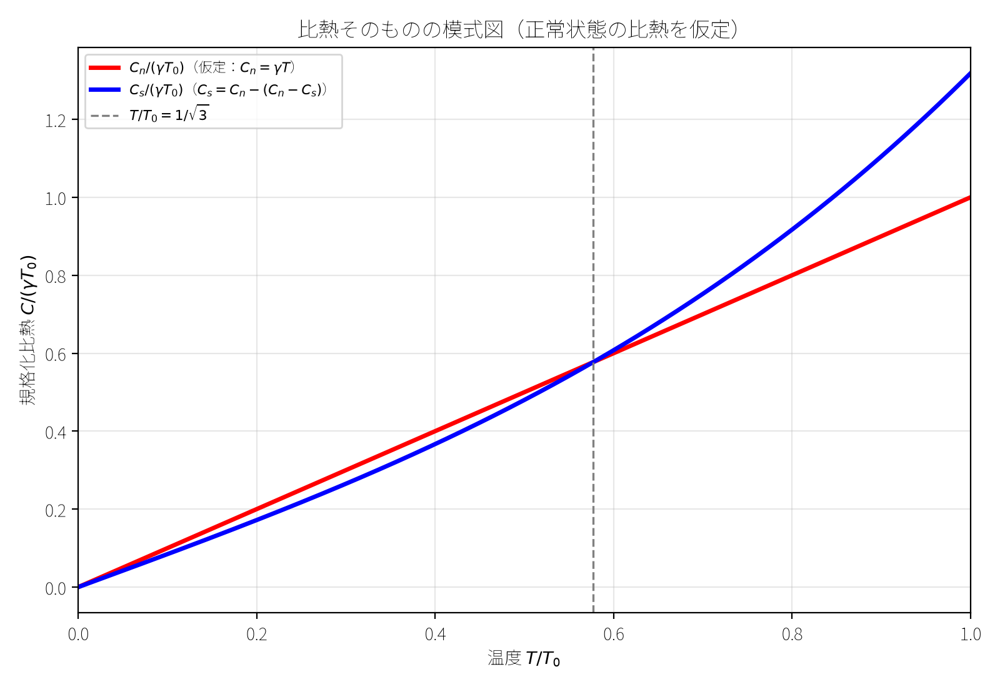
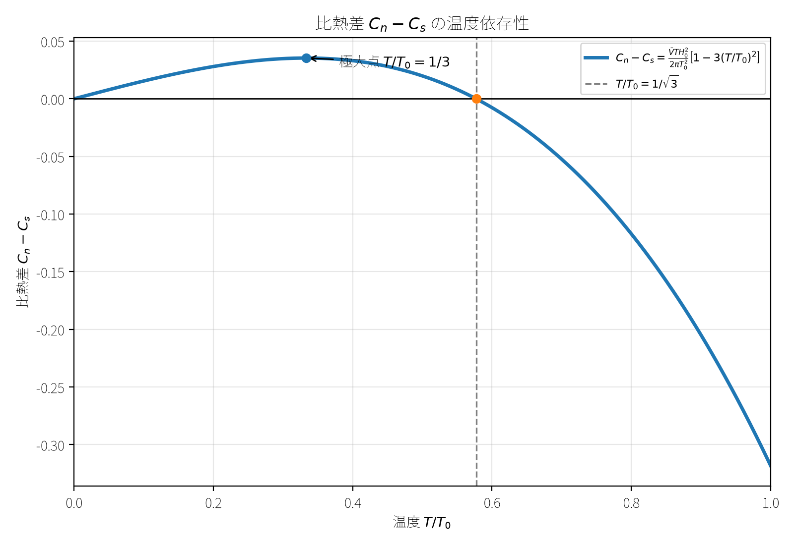

# 演習問題【4-B-36】

## 解答

以下ではガウス単位系を用い，試料の体積 $V$ は一定とする．
また，試料内部の磁場は一様であり，反磁場効果や表面効果は無視する．
問題文のように，超伝導相では $B=0$ ，正常相では $B=H$ となる理想的な超伝導体を考える．

磁場の反転に対して系は対称なので，以下では $H\geq0$ とする．
負の磁場の場合も，最終結果は $H$ を $|H|$ に置き換えれば同じである．
また， $T<T_0$ における $s \to n$ 転移は，相境界

```math
H=H_c(T)
```

で起こる．
したがって，以下の潜熱はこの相境界上で評価する．

### (i) $T<T_0$ ， $H\neq0$ における $s \to n$ 転移の潜熱 $Q$

#### 1．磁場中の Gibbs 自由エネルギー

試料の Helmholtz 自由エネルギーを $F$ ，エントロピーを $S$ ，磁束密度を $B$ ，磁場を $H$ とする．
体積一定の条件下で，磁気的な仕事を含む熱力学関係は，

```math
dF=-S\,dT+\frac{VH}{4\pi}\,dB
```

である．

磁場 $H$ を独立変数とする Gibbs 自由エネルギーを

```math
G=F-\frac{VBH}{4\pi}
```

と定義する．
この全微分を取ると，

```math
\begin{aligned}
dG
&=dF-\frac{V}{4\pi}(B\,dH+H\,dB)\\
&=-S\,dT+\frac{VH}{4\pi}\,dB
-\frac{V}{4\pi}(B\,dH+H\,dB)\\
&=-S\,dT-\frac{VB}{4\pi}\,dH
\end{aligned}
```

となる．
したがって，

```math
\boxed{
dG=-S\,dT-\frac{VB}{4\pi}\,dH
}
\tag{1}
```

であり，

```math
S=-\left(\frac{\partial G}{\partial T}\right)_H
```

が成り立つ．

#### 2．超伝導状態と正常状態の自由エネルギー

零磁場における超伝導状態の自由エネルギーを

```math
F_{s0}(T)=G_s(0,T)
```

と定義する．
これは正常状態の零磁場自由エネルギーとは異なる．

超伝導状態では Meissner 効果により $B=0$ であるから，式 (1) より，

```math
dG_s=-S_s\,dT
```

となる．
したがって，磁場を変化させても超伝導状態の Gibbs 自由エネルギーは変化せず，

```math
\boxed{
G_s(H,T)=F_{s0}(T)
}
\tag{2}
```

である．

一方，正常状態では $B=H$ なので，式 (1) より，

```math
dG_n=-S_n\,dT-\frac{VH}{4\pi}\,dH
```

となる．
温度 $T$ を一定にして磁場を変化させると，

```math
dG_n=-\frac{VH}{4\pi}\,dH
```

である．

相境界 $H=H_c(T)$ では両相が熱力学的平衡にあるため，

```math
G_n(H_c,T)=G_s(H_c,T)=F_{s0}(T)
```

が成立する．
これを基準として積分すると，

```math
\begin{aligned}
G_n(H,T)
&=G_n(H_c,T)
-\frac{V}{4\pi}\int_{H_c}^{H}H'\,dH'\\
&=F_{s0}(T)
-\frac{V}{8\pi}(H^2-H_c^2)
\end{aligned}
```

となる．
よって，

```math
\boxed{
G_n(H,T)
=
F_{s0}(T)
-\frac{V}{8\pi}
\left[H^2-H_c(T)^2\right]
}
\tag{3}
```

を得る．

この式を $H=0$ まで正常状態の自由エネルギーの枝として外挿すると，

```math
G_n(0,T)-G_s(0,T)
=
\frac{VH_c(T)^2}{8\pi}
```

となる．
したがって， $F_{s0}(T)$ は超伝導状態の零磁場自由エネルギーであり，正常状態の零磁場自由エネルギーと同一ではない．

#### 3．エントロピー差

エントロピーは Gibbs 自由エネルギーを温度で偏微分することで得られる．
磁場 $H$ を一定に保つと，

```math
S=-\left(\frac{\partial G}{\partial T}\right)_H
```

である．

式 (2) より，超伝導状態のエントロピーは，

```math
S_s=-\frac{dF_{s0}}{dT}
```

である．

一方，式 (3) より，正常状態のエントロピーは，

```math
\begin{aligned}
S_n
&=-\left(\frac{\partial G_n}{\partial T}\right)_H\\
&=-\frac{dF_{s0}}{dT}
-\frac{V}{8\pi}\frac{dH_c^2}{dT}
\end{aligned}
```

となる．
ここでは $H$ を固定して偏微分しているため， $H^2$ の温度微分はゼロである．

したがって，両相のエントロピー差は，

```math
\boxed{
S_n-S_s
=
-\frac{V}{8\pi}\frac{dH_c^2}{dT}
}
\tag{4}
```

となる．

#### 4．潜熱 $Q$

$s \to n$ 転移において系が吸収する熱を $Q$ と定義する．
相転移の潜熱は，転移温度とエントロピー変化の積であるから，

```math
Q=T(S_n-S_s)
```

である．
式 (4) を代入すると，

```math
\begin{aligned}
Q
&=-\frac{TV}{8\pi}\frac{dH_c^2}{dT}\\
&=-\frac{TV}{4\pi}H_c\frac{dH_c}{dT}
\end{aligned}
```

となる．
よって，

```math
\boxed{
Q
=
-\frac{TV}{8\pi}\frac{dH_c^2}{dT}
=
-\frac{TV}{4\pi}H_c\frac{dH_c}{dT}
}
\tag{5}
```

を得る．

通常， $T<T_0$ では $H_c>0$ であり，限界磁場は温度とともに減少するため，

```math
\frac{dH_c}{dT}<0
```

である．
したがって，

```math
Q>0
```

となる．
これは，超伝導状態から正常状態への転移に際して，試料が熱を吸収することを意味する．

なお，式 (5) の $Q$ は試料全体が吸収する熱量である．
1モル当たりの潜熱 $q$ は，物質量を $n=V/\bar V$ として，

```math
q=\frac{Q}{n}
=
-\frac{\bar VT}{4\pi}H_c\frac{dH_c}{dT}
```

である．

### (ii) Rutgers の式の導出

#### 1．比熱差とエントロピー差の関係

試料全体の熱容量を $\mathcal C_s,\mathcal C_n$ ，モル比熱を $C_s,C_n$ と区別する．
試料の物質量を $n$ とすれば，

```math
C_s=\frac{\mathcal C_s}{n},
\qquad
C_n=\frac{\mathcal C_n}{n}
```

である．

定磁場における試料全体の熱容量は，

```math
\mathcal C=T\left(\frac{\partial S}{\partial T}\right)_H
```

で定義される．
したがって，

```math
\mathcal C_n-\mathcal C_s
=
T\left(\frac{\partial(S_n-S_s)}{\partial T}\right)_H
```

となる．
式 (4) より，

```math
S_n-S_s=-\frac{V}{8\pi}\frac{dH_c^2}{dT}
```

であるから，

```math
\mathcal C_n-\mathcal C_s
=
-\frac{TV}{8\pi}\frac{d^2H_c^2}{dT^2}
\tag{6}
```

を得る．

ここで，

```math
\frac{dH_c^2}{dT}
=
2H_c\frac{dH_c}{dT}
```

である．
さらに積の微分を用いると，

```math
\frac{d^2H_c^2}{dT^2}
=
2\left(\frac{dH_c}{dT}\right)^2
+
2H_c\frac{d^2H_c}{dT^2}
```

となる．
これを式 (6) に代入すれば，

```math
\boxed{
\mathcal C_n-\mathcal C_s
=
-\frac{TV}{4\pi}
\left[
\left(\frac{dH_c}{dT}\right)^2
+
H_c\frac{d^2H_c}{dT^2}
\right]
}
\tag{7}
```

を得る．

#### 2．転移温度 $T=T_0$ での関係

転移温度では限界磁場がゼロになるため，

```math
H_c(T_0)=0
```

である．
したがって，式 (7) の第2項は消え，

```math
\mathcal C_n-\mathcal C_s
=
-\frac{T_0V}{4\pi}
\left(\frac{dH_c}{dT}\right)^2_{T=T_0}
```

となる．
よって，

```math
\mathcal C_s-\mathcal C_n
=
\frac{T_0V}{4\pi}
\left(\frac{dH_c}{dT}\right)^2_{T=T_0}
\tag{8}
```

である．

ここで，試料の物質量を $n$ ，モル体積を $\bar V$ とすると，

```math
V=n\bar V
```

である．
試料全体の熱容量差をモル比熱差に換算するため，式 (8) を $n$ で割ると，

```math
C_s-C_n
=
\frac{T_0\bar V}{4\pi}
\left(\frac{dH_c}{dT}\right)^2_{T=T_0}
```

となる．
両辺を整理すれば，

```math
\boxed{
\left(\frac{dH_c}{dT}\right)^2_{T=T_0}
=
\frac{4\pi}{\bar V}
\left(\frac{C_s-C_n}{T_0}\right)_{T=T_0}
}
```

を得る．
これが Rutgers の式である．

### (iii) $H_c=H_0 \left\{1-(T/T_0)^2 \right\}$ の場合の比熱差

与えられた限界磁場の温度依存性は，

```math
H_c(T)=H_0\left[1-\left(\frac{T}{T_0}\right)^2\right]
```

である．
式 (6) を用いて一般の温度におけるモル比熱差を求める．

まず，

```math
H_c^2
=
H_0^2
\left[
1-2\left(\frac{T}{T_0}\right)^2
+\left(\frac{T}{T_0}\right)^4
\right]
```

である．
これを温度 $T$ で1回微分すると，

```math
\frac{dH_c^2}{dT}
=
H_0^2
\left(
-\frac{4T}{T_0^2}
+\frac{4T^3}{T_0^4}
\right)
```

となる．
さらにもう1回微分すると，

```math
\frac{d^2H_c^2}{dT^2}
=
H_0^2
\left(
-\frac{4}{T_0^2}
+\frac{12T^2}{T_0^4}
\right)
```

を得る．

式 (6) より，試料全体の熱容量差は，

```math
\begin{aligned}
\mathcal C_n-\mathcal C_s
&=-\frac{TV}{8\pi}\frac{d^2H_c^2}{dT^2}\\
&=\frac{TVH_0^2}{8\pi}
\left(
\frac{4}{T_0^2}
-\frac{12T^2}{T_0^4}
\right)\\
&=\frac{VTH_0^2}{2\pi T_0^2}
\left[
1-3\left(\frac{T}{T_0}\right)^2
\right]
\end{aligned}
```

となる．
これを物質量 $n=V/\bar V$ で割ると，

```math
\boxed{
C_n-C_s
=
\frac{\bar VTH_0^2}{2\pi T_0^2}
\left[
1-3\left(\frac{T}{T_0}\right)^2
\right]
}
\tag{9}
```

である．
したがって，

```math
\boxed{
C_s
=
C_n
-
\frac{\bar VTH_0^2}{2\pi T_0^2}
\left[
1-3\left(\frac{T}{T_0}\right)^2
\right]
}
```

となる．

この式は，超伝導状態と正常状態のモル比熱の差を与える．
正常状態の比熱 $C_n(T)$ 自体は問題文で指定されていないため，両相の絶対的な比熱曲線を個別に決めることはできない．
ここでは，比熱差 $C_n-C_s$ を図示する．

#### 比熱差の符号とグラフ

```math
\Delta C=C_n-C_s
```

とおく．
式 (9) の符号は，

```math
1-3\left(\frac{T}{T_0}\right)^2
```

によって決まる．
これがゼロとなる温度は，

```math
1-3\left(\frac{T}{T_0}\right)^2=0
```

より，

```math
\boxed{
T=\frac{T_0}{\sqrt3}
}
```

である．
また，式 (9) には温度 $T$ 自体も含まれるため， $T=0$ でも比熱差はゼロとなる．

したがって，

```math
\begin{cases}
C_n-C_s=0,
& T=0,\\[2mm]
C_n-C_s>0,
&0<T<T_0/\sqrt3,\\[2mm]
C_n-C_s=0,
&T=T_0/\sqrt3,\\[2mm]
C_n-C_s<0,
&T_0/\sqrt3<T\leq T_0.
\end{cases}
```

グラフの極大点も求める．

```math
x=\frac{T}{T_0},
\qquad
\Delta C_*=\frac{\bar V H_0^2}{2\pi T_0}
```

と定義すると，

```math
\frac{\Delta C}{\Delta C_*}=x(1-3x^2)
```

となる．
これを $x$ で微分すると，

```math
\frac{d}{dx}
\left(\frac{\Delta C}{\Delta C_*}\right)
=1-9x^2
```

である．
したがって，極大点は，

```math
x=\frac13
```

すなわち，

```math
\boxed{T=\frac{T_0}{3}}
```

である．
このとき，

```math
\frac{\Delta C_{\max}}{\Delta C_*}
=
\frac13\left(1-\frac13\right)
=
\frac29
```

となる．

以上より，比熱差の曲線は $T=0$ でゼロから始まり， $T=T_0/3$ で極大となる．
その後減少し， $T=T_0/\sqrt3$ で再びゼロとなり，それより高温では負となる．
転移温度 $T=T_0$ では，

```math
C_n-C_s
=
-\frac{\bar V H_0^2}{\pi T_0}
```

であり，

```math
C_s-C_n
=
\frac{\bar V H_0^2}{\pi T_0}>0
```

となる．
これは Rutgers の式に $dH_c/dT|_{T_0}=-2H_0/T_0$ を代入した結果とも一致する．




