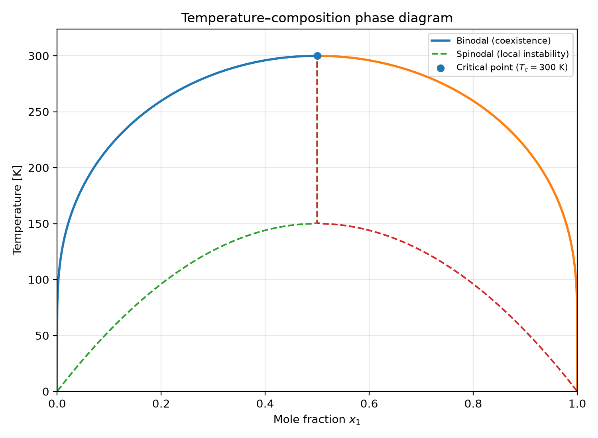

# 例題【4-R-7】

## 解答

### (1) ギブス自由エネルギーと各成分の化学ポテンシャル

2成分溶液の各成分の物質量を $n_1,n_2$ ，モル分率を $x_1,x_2$ とする．

```math
x_1=\frac{n_1}{n_1+n_2},\qquad x_2=\frac{n_2}{n_1+n_2},\qquad x_1+x_2=1
```

問題の仮定は，混合エンタルピーが

```math
\Delta H=A x_1x_2
```

というモルあたりの形で与えられるということである．
したがって，全混合エンタルピーは

```math
\Delta H_{\mathrm{total}} =(n_1+n_2)Ax_1x_2 =\frac{A n_1n_2}{n_1+n_2}
\tag{1}
```

である．

正規溶液では，混合エントロピーは理想溶液と同じである．
そのため，全ギブス自由エネルギーは

```math
\begin{aligned}
G={}&n_1\overline{G}_1^o+n_2\overline{G}_2^o\\
&+(n_1+n_2)\left[ Ax_1x_2+RT(x_1\ln x_1+x_2\ln x_2) \right]
\end{aligned}
\tag{2}
```

と表される．
ここで， $\overline{G}_i^o$ は純成分 $i$ のモルギブス自由エネルギーである．

成分 $i$ の化学ポテンシャルは，全ギブス自由エネルギーをその成分の物質量で偏微分して求められる．
式(2)を偏微分すると，

```math
\boxed{
\overline{G}_1 =\overline{G}_1^o+Ax_2^2+RT\ln x_1
}
\tag{3}
```

```math
\boxed{
\overline{G}_2 =\overline{G}_2^o+Ax_1^2+RT\ln x_2
}
\tag{4}
```

となる．
以下では，これらの式を用いて蒸気圧と相分離を調べる．

### (2) 蒸気圧と組成の関係

液相と気相が平衡にあるとき，成分 $i$ の化学ポテンシャルは両相で等しい．
気相を理想気体とすると，

```math
\overline{G}_i =\overline{G}_{i,\mathrm{gas}}^o+RT\ln p_i
\tag{5}
```

と書ける．
ここでは圧力の対数に含まれる基準圧力を省略した表記を用いている．

純成分 $i$ の飽和蒸気圧を $p_i^o$ とすると，純成分についても同様に

```math
\overline{G}_i^o =\overline{G}_{i,\mathrm{gas}}^o+RT\ln p_i^o
\tag{6}
```

が成り立つ．
式(3)，(4)を式(5)に代入し，式(6)と比較すると，

```math
\boxed{
p_1=x_1p_1^o \exp\left(\frac{Ax_2^2}{RT}\right)
}
\tag{7}
```

```math
\boxed{
p_2=x_2p_2^o \exp\left(\frac{Ax_1^2}{RT}\right)
}
\tag{8}
```

を得る．
これらが求める蒸気圧と組成の関係である．

#### $A$ の符号による違い

- $A=0$ の場合

式(7)，(8)はラウールの法則

```math
p_i=x_i p_i^o
```

に一致する．

- $A<0$ の場合

指数関数の因子は $1$ より小さい．
したがって，

```math
p_i<x_i p_i^o
```

となり，蒸気圧はラウールの法則から負に偏倚する．
混合によってエンタルピーが低下するため，混合状態がエネルギー的に有利になる傾向がある．

- $A>0$ の場合

指数関数の因子は $1$ より大きい．
したがって，

```math
p_i>x_i p_i^o
```

となり，蒸気圧はラウールの法則から正に偏倚する．
混合によってエンタルピーが増加するため，十分に大きな $A$ では相分離が起こり得る．

また， $x_i\to1$ では成分 $i$ が純成分に近づくので， $p_i\to p_i^o$ となる．
一方， $x_i\to0$ では $p_i\to0$ である．
希薄極限では，式(7)，(8)から

```math
p_i\simeq x_i p_i^o \exp\left(\frac{A}{RT}\right)
```

となるため，蒸気圧はモル分率に比例する．
これはヘンリーの法則の形である．

#### 蒸気圧曲線が極大を持つ条件

式(7)の両辺の対数をとると，

```math
\ln p_1=\ln p_1^o+\ln x_1 +\frac{A(1-x_1)^2}{RT}
```

である．
これを $x_1$ で微分すると，

```math
\frac{\partial\ln p_1}{\partial x_1} =\frac{1}{x_1}-\frac{2A(1-x_1)}{RT}
\tag{9}
```

となる．
$p_1>0$ なので，蒸気圧曲線の傾きの符号は式(9)の符号と同じである．

極大または極小を持つ点では，

```math
\frac{1}{x_1} -\frac{2A(1-x_1)}{RT}=0
```

すなわち，

```math
2A x_1(1-x_1)=RT \tag{10}
```

が成り立つ．
ここで，

```math
x_1(1-x_1)\leq\frac{1}{4}
```

であることを使うと，式(10)を満たす組成が存在するには

```math
\frac{A}{RT}\geq2 \tag{11}
```

が必要である．
等号は $x_1=1/2$ で成立する臨界条件である．
したがって，蒸気圧曲線が内部の組成で極大・極小を持ち得るのは， $A/(RT)>2$ の場合である．
この条件は，後で求める均一相の局所的不安定性の条件と一致する．

### (3) 相分離の条件

相分離の有無は，ギブス自由エネルギーが組成によってどのように変化するかで判定する．
全組成を $x=x_1$ ， $x_2=1-x$ とし，モルあたりのギブス自由エネルギーを $g(x)$ とすると，

```math
\begin{aligned}
g(x)={}&x\overline{G}_1^o+(1-x)\overline{G}_2^o\\
&+Ax(1-x)\\
&+RT\left[x\ln x+(1-x)\ln(1-x)\right]
\end{aligned}
\tag{12}
```

となる．

1階微分は，

```math
\frac{dg}{dx} =(\overline{G}_1^o-\overline{G}_2^o) +A(1-2x) +RT\ln\frac{x}{1-x}
\tag{13}
```

である．
さらに微分すると，

```math
\boxed{
\frac{d^2g}{dx^2} =-2A+\frac{RT}{x(1-x)}
}
\tag{14}
```

を得る．

均一相が局所的に安定であるためには，ギブス自由エネルギーが組成に対して凸であること，すなわち $d^2g/dx^2>0$ であることが必要である．
逆に， $d^2g/dx^2<0$ となる組成では，わずかな組成揺らぎによって自由エネルギーが低下するため，均一相は局所的に不安定となる．

式(14)で $x(1-x)\leq1/4$ を使うと，

```math
\frac{d^2g}{dx^2}\geq4RT-2A
\tag{15}
```

となる．
したがって，曲率が負となる組成が存在する条件は

```math
4RT-2A<0
```

すなわち，

```math
\boxed{
\frac{A}{RT}>2}
\tag{16}
```

である．
これは，均一相が局所的に不安定になる領域が現れる条件である．

この条件から臨界温度 $T_c$ は

```math
\boxed{
T_c=\frac{A}{2R}
}
\tag{17}
```

と求まる．
ただし，この式は $A>0$ の場合に意味を持つ．
$A\leq0$ では，この正規溶液モデルにおいて相分離を引き起こす臨界温度は存在しない．

注意すべき点は，式(16)が局所的不安定性の条件であることである．
均一相の曲率が正であっても，2つの異なる組成の相に分かれることで全体のギブス自由エネルギーが低下する場合がある．
実際の2相共存範囲は，共通接線の条件で決定する．

### (4) 共通接線と2相共存組成

2相が平衡共存する場合，それぞれの相における各成分の化学ポテンシャルが等しくなければならない．
ギブス自由エネルギーのグラフでは，これは2つの共存組成において同じ接線が引けること，すなわち共通接線の条件に相当する．

このモデルでは，組成を $x$ とした混合自由エネルギーの曲線は，純成分の項を除けば $x=1/2$ を中心に対称である．
そのため，2相の共存組成を $x_1^a,x_1^b$ とすると，

```math
x_1^a=\frac{1-y}{2},\qquad x_1^b=\frac{1+y}{2}
\tag{18}
```

と表せる．
ここで $0\leq y\leq1$ である．

共通接線の条件を式(13)に適用すると，2つの共存組成での傾きが等しくなる．
式(18)を代入して整理すると，

```math
\frac{1}{2}\ln\frac{1+y}{1-y} =\frac{Ay}{2RT}
\tag{19}
```

を得る．
双曲線正接の逆関数を用いれば，これは

```math
\boxed{
y=\tanh\left(\frac{Ay}{2RT}\right)
}
\tag{20}
```

と書ける．

$y=0$ は臨界組成 $x_1^a=x_1^b=1/2$ に対応する．
これ以外の解 $y>0$ が存在するのは，

```math
\frac{A}{2RT}>1
```

すなわち $T<T_c$ の場合である．
温度が臨界温度に近づくと $y\to0$ となり，2相の組成は $x_1=1/2$ に近づいて一致する．
温度が下がると $y$ が大きくなり，2相の組成差も大きくなる．

### (5) 相図の形状

式(18)～(20)で求めた共存組成 $x_1^a(T),x_1^b(T)$ を温度に対して描くと，相図が得られる．



正規溶液の相図の模式図．臨界温度の下側に2相共存領域が現れ，その境界は臨界点で合流する．

- $T>T_c$ ： すべての組成で均一な単相が安定である．
- $T=T_c$ ： 臨界組成 $x_1=1/2$ で2相の共存組成が一致する．
- $T<T_c$ ： 2相共存領域が現れる．共存曲線の内側では，異なる組成 $x_1^a,x_1^b$ の2相に分離するほうが熱力学的に安定である．

したがって，相図は臨界点を頂点とする左右対称のドーム状，すなわち釣鐘型の相分離領域を持つ．
このモデルでは臨界温度は $T_c=A/(2R)$ である．

## 3．結論

正規溶液の蒸気圧は，

\\[ \boxed{ p_1=x_1p_1^o\exp\left(\frac{Ax_2^2}{RT}\right),\qquad p_2=x_2p_2^o\exp\left(\frac{Ax_1^2}{RT}\right) } \\]

で与えられる．
$A<0$ では蒸気圧はラウールの法則から負に偏倚し， $A>0$ では正に偏倚する．

また，均一相が局所的に不安定になる条件は

\\[ \frac{A}{RT}>2 \\]

であり，臨界温度は

\\[ \boxed{T_c=\frac{A}{2R}} \\]

である．
ただし，実際の2相共存領域は自由エネルギーの共通接線によって決定される．
その結果， $T<T_c$ では臨界組成 $x_1=1/2$ を中心とした対称なドーム状の相分離領域が形成される．
