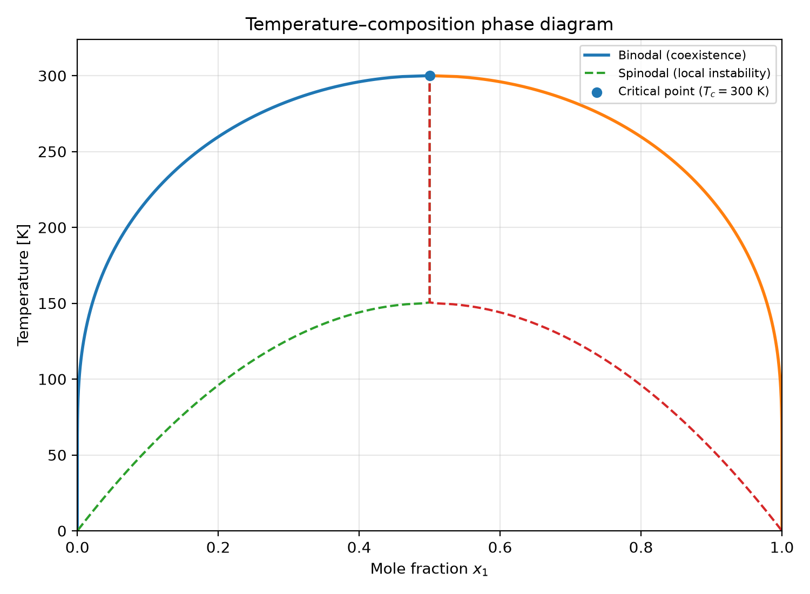

# 例題【4-R-7】

## 解答

### 1．ギブス自由エネルギーと各成分の化学ポテンシャル

2成分溶液の各成分の物質量を $n_1,n_2$ ，モル分率を $x_1,x_2$ とする．

```math
x_1=\frac{n_1}{n_1+n_2},
\qquad
x_2=\frac{n_2}{n_1+n_2},
\qquad
x_1+x_2=1
```

問題の仮定は，混合エンタルピーがモルあたり

```math
\Delta\bar H=Ax_1x_2
```

で与えられるということである．
ここで $A$ は温度に依存しない定数とする．
したがって，全混合エンタルピーは，

```math
\begin{aligned}
\Delta H_{\mathrm{total}}
&=(n_1+n_2)Ax_1x_2\\
&=\frac{An_1n_2}{n_1+n_2}
\end{aligned}
\tag{1}
```

となる．

正規溶液では混合エントロピーは理想溶液と同じである．
したがって，全ギブス自由エネルギーは，

```math
\begin{aligned}
G={}&n_1\overline G_1^o+n_2\overline G_2^o\\
&+(n_1+n_2)
\left[
Ax_1x_2
+RT(x_1\ln x_1+x_2\ln x_2)
\right]
\end{aligned}
\tag{2}
```

と表される．
ここで， $\overline G_i^o$ は純成分 $i$ のモルギブス自由エネルギーである．

成分 $i$ の化学ポテンシャルは，

```math
\overline G_i=
\left(\frac{\partial G}{\partial n_i}\right)_{T,P,n_{j\ne i}}
```

である．
式 (2) を偏微分すると，

```math
\boxed{
\overline G_1
=
\overline G_1^o+Ax_2^2+RT\ln x_1
}
\tag{3}
```

```math
\boxed{
\overline G_2
=
\overline G_2^o+Ax_1^2+RT\ln x_2
}
\tag{4}
```

を得る．

### 2．均一液相の蒸気圧と組成の関係

液相と気相が平衡にあるとき，成分 $i$ の化学ポテンシャルは両相で等しい．
気相を理想気体混合物とすると，

```math
\overline G_{i,\mathrm{gas}}
=
\overline G_{i,\mathrm{gas}}^o
+RT\ln\frac{p_i}{p^\circ}
\tag{5}
```

である．
ここで， $p_i$ は成分 $i$ の分圧， $p^\circ$ は標準圧力である．

純成分 $i$ の飽和蒸気圧を $p_i^o$ とすると，

```math
\overline G_i^o
=
\overline G_{i,\mathrm{gas}}^o
+RT\ln\frac{p_i^o}{p^\circ}
\tag{6}
```

となる．
ここでは，液相の圧力依存性によるPoynting補正は無視する．

式 (3)，(4) を式 (5) に代入し，式 (6) と比較すると，

```math
\boxed{
p_1=x_1p_1^o
\exp\left(\frac{Ax_2^2}{RT}\right)
}
\tag{7}
```

```math
\boxed{
p_2=x_2p_2^o
\exp\left(\frac{Ax_1^2}{RT}\right)
}
\tag{8}
```

を得る．

これらは均一液相の組成に対する各成分の分圧である．
気相も理想気体と仮定しているので，全蒸気圧はDaltonの法則より，

```math
\boxed{P=p_1+p_2}
\tag{9}
```

である．

**$A$ の符号による違い**

- **$A=0$ の場合**

式 (7)，(8) はラウールの法則，

```math
p_i=x_ip_i^o
```

に一致する．

- **$A<0$ の場合**

指数関数の因子は1より小さい．
したがって，

```math
p_i<x_ip_i^o
```

となり，蒸気圧はラウールの法則から負に偏倚する．
混合エンタルピーが負であり，混合によってエネルギー的に安定化する傾向がある．

- **$A>0$ の場合**

指数関数の因子は1より大きい．
したがって，

```math
p_i>x_ip_i^o
```

となり，蒸気圧はラウールの法則から正に偏倚する．
混合エンタルピーが正であり，十分に大きな $A$ では相分離が起こり得る．

また，純成分極限では，

```math
\lim_{x_i\to1}p_i=p_i^o
```

であり，希薄極限では，

```math
p_i
\simeq
x_ip_i^o\exp\left(\frac{A}{RT}\right)
```

となる．
したがって，希薄極限ではヘンリーの法則に従う．

### 3．均一液相の分圧曲線の極値と局所安定性

式 (7) の対数を取り， $x=x_1$ ， $x_2=1-x$ とおくと，

```math
\ln p_1
=
\ln p_1^o+\ln x
+\frac{A(1-x)^2}{RT}
```

である．
これを $x$ で微分すると，

```math
\boxed{
\frac{d\ln p_1}{dx}
=
\frac1x-\frac{2A(1-x)}{RT}
}
\tag{10}
```

となる．

したがって，分圧曲線の停留点は，

```math
2Ax(1-x)=RT
\tag{11}
```

を満たす．

```math
x(1-x)\leq\frac14
```

より，内部の停留点が存在する条件は，

```math
\boxed{\frac{A}{RT}\geq2}
\tag{12}
```

である．
ただし，等号の場合は $x=1/2$ の水平な変曲点であり，極大・極小ではない．
実際に極大・極小が現れるのは，

```math
\frac{A}{RT}>2
```

の場合である．

成分2の分圧についても，

```math
\frac{d\ln p_2}{dx}
=
-\frac1{1-x}+\frac{2Ax}{RT}
```

であるため，停留点の条件は同じ式 (11) となる．

次に，モルあたりのギブス自由エネルギーを，

```math
\begin{aligned}
g(x)={}&x\overline G_1^o+(1-x)\overline G_2^o\\
&+Ax(1-x)\\
&+RT[x\ln x+(1-x)\ln(1-x)]
\end{aligned}
\tag{13}
```

とする．

2階微分すると，

```math
\boxed{
\frac{d^2g}{dx^2}
=
-2A+\frac{RT}{x(1-x)}
}
\tag{14}
```

となる．

均一相が局所的に安定であるためには，

```math
\frac{d^2g}{dx^2}>0
```

でなければならない．
逆に，

```math
\frac{d^2g}{dx^2}<0
```

となる組成では，微小な組成揺らぎによって自由エネルギーが低下するため，均一相は局所的に不安定である．

式 (14) より，局所的不安定性が現れる条件は，

```math
2Ax(1-x)>RT
```

である．
そのような組成が存在する条件は，

```math
\boxed{
\frac{A}{RT}>2
}
\tag{15}
```

である．

したがって，臨界温度は，

```math
\boxed{
T_c=\frac{A}{2R}
}
\tag{16}
```

であり，臨界組成は，

```math
\boxed{x_c=\frac12}
```

である．
ただし，正の臨界温度が存在するのは $A>0$ の場合に限る．
$A\leq0$ では，このモデルにおいて相分離を引き起こす正の臨界温度は存在しない．

式 (11) と式 (14) を比較すると，均一液相の各成分の分圧曲線の停留点は，局所安定性が失われるスピノーダル境界に対応する．

$T<T_c$ のとき，その境界は，

```math
\boxed{
x_s^\pm
=
\frac12
\left(
1\pm\sqrt{1-\frac{2RT}{A}}
\right)
}
\tag{17}
```

で与えられる．
ここで $x_s^-$ と $x_s^+$ はスピノーダル組成である．

### 4．共通接線と二相共存組成

局所安定性だけでは，実際の二相共存範囲は決まらない．
二相が熱力学的に平衡共存するためには，両相で各成分の化学ポテンシャルが等しくなければならない．
これはギブス自由エネルギー曲線の共通接線条件に相当する．

正規溶液モデルの混合自由エネルギー部分は，

```math
h(x)=Ax(1-x)+RT[x\ln x+(1-x)\ln(1-x)]
```

であり，

```math
h(x)=h(1-x)
```

という対称性を持つ．

したがって，二つの共存組成を，

```math
x_1^a=\frac{1-y}{2},
\qquad
x_1^b=\frac{1+y}{2}
\tag{18}
```

と表せる．
ここで $0<y<1$ である．

二つの液相で成分1の化学ポテンシャルが等しいという条件，

```math
\overline G_1(x_1^a)=\overline G_1(x_1^b)
```

を式 (3) に適用すると，

```math
RT\ln\frac{x_1^b}{x_1^a}
=
A\left[(1-x_1^a)^2-(1-x_1^b)^2\right]
```

となる．
式 (18) を代入すると，

```math
\boxed{
\frac12\ln\frac{1+y}{1-y}
=
\frac{Ay}{2RT}
}
\tag{19}
```

を得る．

成分2についても同じ条件が成立する．
これは混合自由エネルギーの対称性によるものであり，両成分の化学ポテンシャルがともに等しくなる．
したがって，共通接線条件を満たしている．

双曲線正接の逆関数を用いれば，

```math
\boxed{
y=\tanh\left(\frac{Ay}{2RT}\right)
}
\tag{20}
```

と表せる．

非零の解 $y>0$ が存在するのは，

```math
\frac{A}{2RT}>1
```

すなわち，

```math
\boxed{T<T_c}
```

の場合である．

このとき，

```math
x_1^a=\frac{1-y}{2},
\qquad
x_1^b=\frac{1+y}{2}
```

が二相共存組成となる．

この共存組成を与える曲線がビノーダルである．
一方，式 (17) のスピノーダルは均一相の局所安定性が失われる境界である．
両者は異なり， $T<T_c$ ではスピノーダルはビノーダルの内側に位置する．

ビノーダルとスピノーダルの間では均一相は局所的には安定であるものの，二相に分離した状態の方が全体のギブス自由エネルギーは低くなるため，均一相は準安定である．
スピノーダルの内側では均一相は局所的にも不安定である．

### 5．二相分離領域における蒸気圧

ここが重要である．
式 (7)，(8) は均一液相の組成に対する分圧式である．
二相分離が起きた場合，二つの共存液相の組成は $x_1^a,x_1^b$ であり，全体組成 $x_0$ を式 (7)，(8) にそのまま代入することはできない．

固定温度 $T<T_c$ において，二つの液相が平衡共存している場合を考える．
二つの共存組成は，

```math
x_1^a=\frac{1-y}{2},
\qquad
x_1^b=\frac{1+y}{2}
```

である．

共存液相で化学ポテンシャルが等しいため，各成分の分圧も等しくなければならない．
実際に式 (7) を用いると，

```math
\begin{aligned}
\ln\frac{p_1(x_1^b)}{p_1(x_1^a)}
={}&
\ln\frac{1+y}{1-y}\\
&-\frac{Ay}{RT}
\end{aligned}
```

となる．
式 (19) より，

```math
\ln\frac{1+y}{1-y}=\frac{Ay}{RT}
```

であるから，

```math
\boxed{
p_1(x_1^a)=p_1(x_1^b)
}
\tag{21}
```

となる．

同様に成分2についても，

```math
\boxed{
p_2(x_1^a)=p_2(x_1^b)
}
\tag{22}
```

が成立する．

すなわち，二つの液相が共存しているとき，どちらの液相と平衡にある気相も同じ分圧を持つ．

共存領域における各成分の分圧を $p_1^*,p_2^*$ とおくと，

```math
\boxed{
p_1^*
=
p_1^o\frac{1-y}{2}
\exp\left[\frac{A(1+y)^2}{4RT}\right]
}
\tag{23}
```

```math
\boxed{
p_2^*
=
p_2^o\frac{1+y}{2}
\exp\left[\frac{A(1-y)^2}{4RT}\right]
}
\tag{24}
```

となる．

これらは固定温度で定まる $y$ のみに依存し，全体組成には依存しない．
したがって，全蒸気圧も，

```math
\boxed{
P^*=p_1^*+p_2^*
}
\tag{25}
```

となり，二相共存領域では全体組成を変化させても一定である．

二相共存領域における全体組成を $x_0$ とすれば，

```math
x_1^a\leq x_0\leq x_1^b
```

である．
この範囲で変化するのは，二つの液相の量の割合である．
各液相のモル量の割合を $f_a,f_b$ とすれば，

```math
f_a+f_b=1
```

```math
x_0=f_ax_1^a+f_bx_1^b
```

であるから，

```math
\boxed{
f_a=\frac{x_1^b-x_0}{x_1^b-x_1^a},
\qquad
f_b=\frac{x_0-x_1^a}{x_1^b-x_1^a}
}
\tag{26}
```

となる．

したがって，固定温度で全体組成 $x_0$ を変化させても，二相共存領域では各液相の組成と各成分の分圧は変化せず，液相の量の割合だけが変化する．

よって，平衡状態での蒸気圧と全体組成の関係は，
- ビノーダルの外側では，一つの均一液相の式 (7)，(8) に従う．
- ビノーダルの内側では，二相共存となり，各成分の分圧および全蒸気圧は一定となる．

という形になる．

なお，式 (10) で求めた分圧曲線の極大・極小は，均一液相を仮定したときの停留点であり，スピノーダルに対応する．
実際の平衡蒸気圧では，ビノーダル内の均一液相の枝は二相共存状態に置き換わるため，その領域における平衡分圧は一定となる．

### 6．相図の形状

式 (18)～(20) で求めた共存組成

```math
x_1^a(T),\qquad x_1^b(T)
```

を温度に対して描くと，液液相分離の相図が得られる．
- $T>T_c$ ： すべての組成で均一な単相が安定である．
- $T=T_c$ ： $x_1=1/2$ で臨界点となり，二相の共存組成が一致する．
- $T<T_c$ ： ビノーダルの内側で二つの液相が共存する．

その形状は，臨界点

```math
\boxed{
(T_c,x_c)=\left(\frac{A}{2R},\frac12\right)
}
```

を頂点とする左右対称のドーム状である．

図は次のようになる．



ドームの外側は均一液相，内側は二液相共存領域である．
その内側にはスピノーダル境界が存在し，その境界の内側では均一相が局所的に不安定となる．

したがって，この正規溶液モデルの相図は，臨界組成 $x_1=1/2$ を中心とする対称な液液相分離ドームを持つ．

### 7．最終結論

正規溶液の均一液相における各成分の分圧は，

```math
\boxed{
p_1=x_1p_1^o\exp\left(\frac{Ax_2^2}{RT}\right),
\qquad
p_2=x_2p_2^o\exp\left(\frac{Ax_1^2}{RT}\right)
}
```

で与えられる．

$A<0$ では負の偏倚， $A>0$ では正の偏倚を示す．

$A>0$ で，

```math
\boxed{
T_c=\frac{A}{2R}
}
```

より低温になると液液相分離が起こる．
共存組成は，

```math
\boxed{
x_1^a=\frac{1-y}{2},
\qquad
x_1^b=\frac{1+y}{2},
\qquad
y=\tanh\left(\frac{Ay}{2RT}\right)
}
```

で与えられる．

二相共存領域では，各成分の化学ポテンシャルが両液相で等しいため，成分ごとの分圧も等しくなる．
その結果，固定温度では全体組成を変えても蒸気圧は一定であり，変化するのは二液相の割合だけである．

相図は臨界点を頂点とする対称なドーム状の液液相分離領域を持つ．
