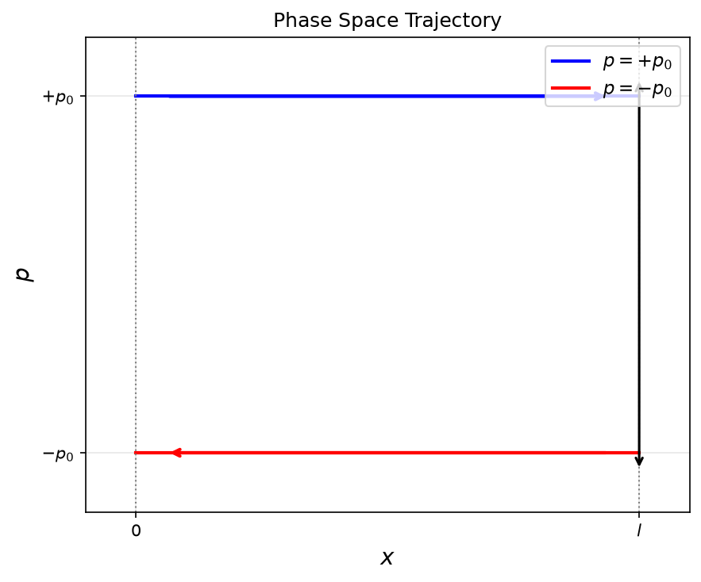

# 演習問題【5-A-5】

## 解答

### (i) 位相空間 $(x,p)$ における軌道

質点は $x=0$ と $x=l$ の間を運動し，壁で弾性反射する．弾性反射では運動量の大きさは変化せず，向きだけが反転する．
そこで，運動量の大きさを $p_0>0$ とすると，質点の運動量は右向きに進むとき $+p_0$，左向きに進むとき $-p_0$ である．

したがって，位相空間上の軌道は

```math
p=+p_0,\qquad 0\leq x\leq l
```

および

```math
p=-p_0,\qquad 0\leq x\leq l
```

という2本の水平な線分からなる．
質点が壁に到達すると運動量の符号が瞬間的に反転するため，位相空間上では $x=l$ または $x=0$ において，一方の線分から他方の線分へ移る軌道となる．



### (ii) エネルギー $E$ 以下の位相空間体積 $\Gamma_0(E)$

質点には位置エネルギーがないものとすると，力学的エネルギーは運動エネルギーに等しく，

```math
E=\frac{p^2}{2m}
```

である．
したがって，エネルギーが $E$ 以下であるための条件は

```math
\frac{p^2}{2m}\leq E
```

すなわち，

```math
-\sqrt{2mE}\leq p\leq\sqrt{2mE}
```

である．
位置 $x$ は $0\leq x\leq l$ の範囲を取るため，エネルギー $E$ 以下の状態が占める位相空間領域は，横幅 $l$ ，縦幅 $2\sqrt{2mE}$ の長方形である．

この1次元系の位相空間体積は，位相空間 $(x,p)$ における面積として定義される．
よって，

```math
\begin{aligned}
\Gamma_0(E)
&=\int_0^l dx
  \int_{-\sqrt{2mE}}^{\sqrt{2mE}}dp\\
&=l\left(2\sqrt{2mE}\right).
\end{aligned}
```

したがって，

```math
\boxed{
\Gamma_0(E)=2l\sqrt{2mE}
}
```

となる．

### (iii) 壁をゆっくり動かす場合の断熱不変性

壁 $x=0$ は固定し，壁 $x=l$ だけをゆっくり動かす．
壁の速度を $u$ とし，移動前の壁の位置を $l$ ，移動後の位置を $l+\delta l$ とする．
このとき，壁が移動する時間は

```math
\delta t=\frac{\delta l}{u}
```

である．
ここでは，壁が膨張するときは $u>0,\ \delta l>0$，収縮するときは $u<0,\ \delta l<0$ とする．

壁の移動が十分遅い，すなわち

```math
|u|\ll\frac{p}{m}
```

であると仮定する．
ここで $p>0$ は衝突前の質点の運動量の大きさである．
この条件のもとでは，壁の移動中に質点は多数回往復し，壁の位置と質点の運動量の変化を連続的な微小変化として近似できる．

#### 1．1回の衝突による運動量の変化

右側の壁に向かって進む質点の衝突前の速度は $p/m$ であり，衝突後の速度は左向きとなる．
衝突後の運動量の大きさを $p'$ とすると，衝突後の速度は $-p'/m$ である．

壁の速度は $u$ であるから，壁から見た衝突前後の相対速度は，弾性衝突によって符号が反転する．
したがって，

```math
\frac{p}{m}-u
=-\left(-\frac{p'}{m}-u\right)
=\frac{p'}{m}+u
```

となる．
これを整理すると，

```math
\frac{p'}{m}=\frac{p}{m}-2u
```

であるから，

```math
p'=p-2mu
```

を得る．
よって，1回の衝突による運動量の大きさの変化は

```math
\Delta p=p'-p=-2mu
\tag{1}
```

である．
壁が外側へ動く場合には $u>0$ であり，質点の運動量の大きさは減少する．

#### 2．壁の移動中に起こる衝突回数

壁の移動が十分遅いので，短い時間内では壁の位置と質点の速さはほぼ一定とみなせる．
質点の速さは $p/m$ であり，固定壁と可動壁の間を往復する時間は近似的に

```math
\tau=\frac{2l}{p/m}=\frac{2ml}{p}
```

である．
可動壁との衝突は1往復につき1回起こるため，単位時間当たりの可動壁との衝突回数は

```math
f=\frac{1}{\tau}=\frac{p}{2ml}
```

である．
したがって，壁が微小距離 $\delta l$ だけ移動する間の衝突回数 $N$ は，近似的に

```math
\begin{aligned}
N&=f\delta t\\
&=\frac{p}{2ml}\frac{\delta l}{u}\\
&=\frac{p\,\delta l}{2mlu}
\end{aligned}
\tag{2}
```

となる．
これは壁の移動中に多数回の衝突が起こるという準静的近似に基づく式である．

#### 3．運動量の変化と位相空間体積の不変性

式 (1)，(2) より，壁の移動中に生じる運動量の大きさの全変化は

```math
\begin{aligned}
\delta p
&=N\Delta p\\
&=\frac{p\,\delta l}{2mlu}(-2mu)\\
&=-\frac{p\,\delta l}{l}
\end{aligned}
```

となる．
したがって，

```math
l\,\delta p=-p\,\delta l
```

であり，

```math
\begin{aligned}
\delta(pl)
&=p\,\delta l+l\,\delta p\\
&=p\,\delta l-p\,\delta l\\
&=0
\end{aligned}
```

を得る．
つまり，壁の位置 $l$ と質点の運動量の大きさ $p$ はそれぞれ変化するが，その積 $pl$ は微小変化の一次の範囲で一定に保たれる．

(ii) で求めた位相空間体積は

```math
\Gamma_0(E)=2lp
```

であるから，

```math
\delta\Gamma_0(E)=2\,\delta(pl)=0
```

となる．
したがって，壁を十分ゆっくり動かすと，位相空間体積 $\Gamma_0(E)$ は不変に保たれる．これが断熱不変性である．

### (iv) 量子力学的な状態数 $\Omega_0(E)$ と $\Gamma_0(E)$ の比較

#### 1．固有エネルギーを求める

量子力学では，質点の状態は波動関数 $\psi(x)$ で表される．
壁は無限に高いポテンシャル壁とみなすため，波動関数は境界でゼロとなる．
すなわち，

```math
\psi(0)=\psi(l)=0
```

である．
領域 $0<x<l$ ではポテンシャルエネルギーがゼロなので，時間に依存しないシュレーディンガー方程式は

```math
-\frac{\hbar^2}{2m}\frac{d^2\psi}{dx^2}
=E\psi
```

となる．
ここで $\hbar=h/(2\pi)$ である．

$E>0$ として

```math
q=\frac{\sqrt{2mE}}{\hbar}
```

とおくと，方程式の一般解は

```math
\psi(x)=A\sin(qx)+B\cos(qx)
```

である．
境界条件 $\psi(0)=0$ を代入すると $B=0$ となる．
さらに， $\psi(l)=0$ より，

```math
A\sin(ql)=0
```

を得る．
波動関数が恒等的にゼロとなる解は物理的な状態ではないため， $A\ne0$ とすると，

```math
\sin(ql)=0
```

である．
よって，

```math
ql=n\pi,\qquad n=1,2,3,\ldots
```

となる．
これを $q=\sqrt{2mE}/\hbar$ に代入すると，

```math
\frac{\sqrt{2mE_n}}{\hbar}l=n\pi
```

であり，固有エネルギーは

```math
\begin{aligned}
E_n
&=\frac{\hbar^2\pi^2n^2}{2ml^2}\\
&=\frac{h^2n^2}{8ml^2}
\end{aligned}
```

となる．
したがって，

```math
\boxed{
E_n=\frac{h^2}{8ml^2}n^2,\qquad n=1,2,3,\ldots
}
```

である．

#### 2．エネルギー $E$ 以下の量子状態数

エネルギー $E$ 以下の状態数 $\Omega_0(E)$ は，条件 $E_n\leq E$ を満たす量子状態の個数である．
したがって，

```math
\Omega_0(E)=\sum_{E_n\leq E}1
```

と表せる．
固有エネルギーの式を代入すると，

```math
\frac{h^2n^2}{8ml^2}\leq E
```

であるから，

```math
n\leq\sqrt{\frac{8ml^2E}{h^2}}
```

となる．
許される量子数 $n$ は正の整数であるため，状態数は右辺以下の最大の整数に等しい．
よって，

```math
\boxed{
\Omega_0(E)=
\left\lfloor\sqrt{\frac{8ml^2E}{h^2}}\right\rfloor
}
```

である．
ここで $\lfloor x\rfloor$ は $x$ 以下の最大の整数を表す．

#### 3．古典的な位相空間体積との比較

(ii) で求めた古典的な位相空間体積は

```math
\Gamma_0(E)=2l\sqrt{2mE}
```

である．
これをプランク定数 $h$ で割ると，

```math
\begin{aligned}
\frac{\Gamma_0(E)}{h}
&=\frac{2l\sqrt{2mE}}{h}\\
&=\sqrt{\frac{8ml^2E}{h^2}}
\end{aligned}
```

となる．
したがって，量子状態数は

```math
\boxed{
\Omega_0(E)=
\left\lfloor\frac{\Gamma_0(E)}{h}\right\rfloor
}
```

と表せる．

この系では，古典的な位相空間体積を $h$ で割った値が，エネルギー $E$ 以下の量子状態数を整数に切り下げた値に対応する．
エネルギーが十分大きく， $\Gamma_0(E)/h\gg1$ となると，整数部分を取ることによる相対的な差は小さくなる．
したがって，

```math
\boxed{
\Omega_0(E)\approx\frac{\Gamma_0(E)}{h}
}
```

が成り立つ．
これは，古典力学で数えた位相空間体積と量子力学で数えた状態数が，プランク定数 $h$ を介して対応することを示している．
