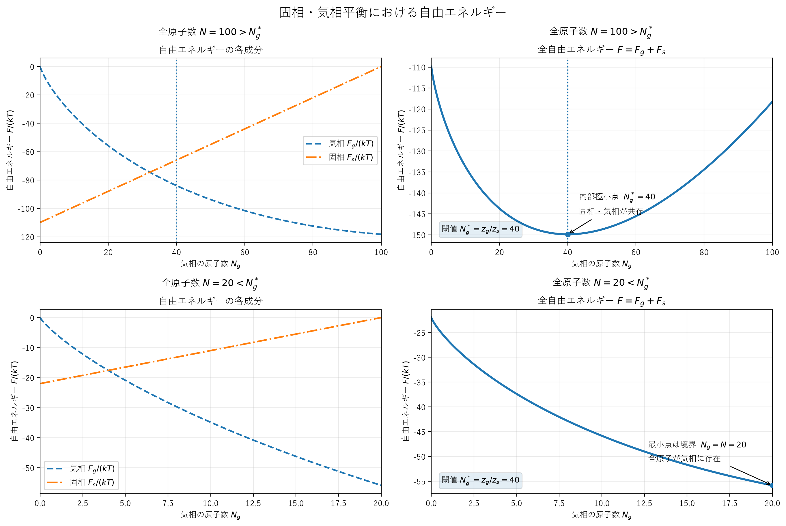

# 演習問題【6-A-11】

## 解答

### 1．気相と固相の Helmholtz 自由エネルギー

容器内の全原子数を $N$ ，気相に存在する原子数を $N_g$ ，固相に存在する原子数を $N_s$ とする．
全原子数は保存されるため，

```math
N=N_g+N_s
\tag{1}
```

である．
また，温度 $T$ と容器の体積 $V$ は一定である．

まず，気相の自由エネルギー $F_g$ を求める．
気体は理想気体とみなせるため， $N_g$ 個の原子からなる気相の分配関数は，

```math
Z_g(T,V,N_g)=\frac{\{z_g(T,V)\}^{N_g}}{N_g!}
```

と表される．
ここで， $z_g(T,V)$ は気体原子1個の分配関数である．

Helmholtz の自由エネルギーは $F=-kT\log Z$ で与えられるため，

```math
F_g=-kT\log Z_g
=-kT\left\{N_g\log z_g-\log N_g!\right\}
```

となる．
ここで $N_g\gg1$ を仮定し，Stirling の公式

```math
\log N_g!\simeq N_g\log N_g-N_g
```

を用いると，

```math
\begin{aligned}
F_g(T,V,N_g)
&\simeq-kTN_g
\left\{\log z_g-\log N_g+1\right\}\\
&=kTN_g\left\{\log\frac{N_g}{z_g}-1\right\}
\end{aligned}
```

を得る．
したがって，

```math
\boxed{
F_g\simeq kTN_g\left(\log\frac{N_g}{z_g}-1\right)
}
\tag{2}
```

である．
以下では， $z_g=z_g(T,V)$ と略記する．

次に，固相の分配関数は問題文より，

```math
Z_s(T,N_s)=\{z_s(T)\}^{N_s}
```

である．
したがって，固相の Helmholtz 自由エネルギーは，

```math
\begin{aligned}
F_s(T,N_s)
&=-kT\log Z_s\\
&=-kTN_s\log z_s(T)
\end{aligned}
```

である．
よって，

```math
\boxed{
F_s=-kTN_s\log z_s
}
\tag{3}
```

を得る．
ここで $z_s=z_s(T)$ と略記する．

### 2．全自由エネルギーの最小化

気相と固相は同じ原子から構成されるため，原子が一方の相から他方の相へ移動できる．
このとき，全自由エネルギーは，

```math
F=F_g+F_s
```

である．
式 (1) より $N_s=N-N_g$ なので， $F$ は $N_g$ の関数として，

```math
F(T,V,N,N_g)
=F_g(T,V,N_g)+F_s(T,N-N_g)
\tag{4}
```

と書ける．
温度，容器の体積，全原子数を固定した熱平衡状態では，この全自由エネルギーが最小となる．
したがって，極小点が許容範囲 $0\leq N_g\leq N$ の内部にある場合には，

```math
\left(\frac{\partial F}{\partial N_g}\right)_{T,V,N}=0
\tag{5}
```

が成り立つ．

まず，式 (2) を $N_g$ で微分すると，

```math
\begin{aligned}
\frac{\partial F_g}{\partial N_g}
&=kT\frac{\partial}{\partial N_g}
\left[
N_g\left(\log\frac{N_g}{z_g}-1\right)
\right]\\
&=kT\left(
\log\frac{N_g}{z_g}+1-1
\right)\\
&=kT\log\frac{N_g}{z_g}
\end{aligned}
\tag{6}
```

を得る．

一方，式 (3) と $N_s=N-N_g$ より，

```math
F_s=-kT(N-N_g)\log z_s
```

であるから，

```math
\boxed{
\frac{\partial F_s}{\partial N_g}=kT\log z_s
}
\tag{7}
```

となる．
ここで $z_s$ は温度 $T$ のみの関数であり， $T$ を一定に保っているため， $N_g$ による微分では定数として扱う．

式 (5)～(7) を合わせると，

```math
kT\log\frac{N_g}{z_g}+kT\log z_s=0
```

である．
両辺を $kT$ で割り，対数の性質を使って整理すれば，

```math
\log\frac{N_gz_s}{z_g}=0
```

となる．
したがって，

```math
\frac{N_gz_s}{z_g}=1
```

であるから，求める平衡条件は，

```math
\boxed{
N_g=\frac{z_g(T,V)}{z_s(T)}
}
\tag{8}
```

となる．
これが示すべき式である．
この結果は，気相の原子数が全原子数だけで決まるのではなく，温度と容器の体積，ならびに気相と固相の1原子当たりの分配関数によって決まることを示している．

### 3．自由エネルギーのグラフと平衡条件

#### 3.1 全自由エネルギーの関数形

式 (2)，(3) を式 (4) に代入すると，

```math
\boxed{
\begin{aligned}
F(N_g)
\simeq{}&
kTN_g\left(\log\frac{N_g}{z_g}-1\right)\\
&-kT(N-N_g)\log z_s
\end{aligned}
}
\tag{9}
```

となる．
ただし， $T,V,N,z_g,z_s$ は固定して考える．
この関数の定義域は，

```math
0\leq N_g\leq N
```

である．

式 (9) を微分すると，

```math
\frac{dF}{dN_g}
=kT\log\frac{N_gz_s}{z_g}
\tag{10}
```

を得る．
さらに，もう一度微分すると，

```math
\boxed{
\frac{d^2F}{dN_g^2}=\frac{kT}{N_g}>0
}
\tag{11}
```

である．
したがって， $N_g>0$ の範囲で全自由エネルギーのグラフは下に凸である．
式 (10) がゼロになる点は式 (8) の $N_g=z_g/z_s$ であり，この点が定義域の内部にあれば，全自由エネルギーの最小点となる．

#### 3.2 全原子数が十分に大きい場合

```math
N>\frac{z_g}{z_s}
```

の場合を考える．
このとき， $N_g=z_g/z_s$ は許容範囲 $0\leq N_g\leq N$ の内部にある．
式 (10) より，この点より小さい $N_g$ では $dF/dN_g<0$ ，大きい $N_g$ では $dF/dN_g>0$ である．
したがって，全自由エネルギーは $N_g=z_g/z_s$ まで減少し，それ以降は増加する．

[図](6-A-11-figure-1.png)

図は定性的なものであり，実際の曲線の形状や縦方向の位置はパラメータに依存する．
重要なのは，極小点が許容範囲の内部にあることである．
このとき，平衡状態では，

```math
N_g=\frac{z_g}{z_s},
\qquad
N_s=N-\frac{z_g}{z_s}
```

となる．
全原子数 $N$ を増加させても，平衡気相原子数 $N_g$ は同じ値を保ち，増加した原子は主として固相に加わる．

#### 3.3 全原子数が小さい場合

一方，

```math
N<\frac{z_g}{z_s}
```

の場合には，式 (10) は許容範囲内のすべての $N_g$ に対して負となる．
したがって，全自由エネルギーは $N_g$ を増加させるほど減少し，最小値は境界 $N_g=N$ で得られる．
つまり，全原子が気相に存在する状態が最も安定であり，固相は形成されない．

[図](6-A-11-figure-1.png)

この場合，式 (8) で与えられる値 $z_g/z_s$ は許容範囲の外にある．
したがって，式 (8) は気相と固相が共存する場合の平衡値としては実現できない．

以上より，固相が現れるための条件は，近似的に，

```math
\boxed{
N\geq\frac{z_g(T,V)}{z_s(T)}
}
\tag{12}
```

である．
等号では $N_s=0$ となるため，有限量の固相と気相が共存するためには，厳密には $N>z_g/z_s$ が必要である．

### 4．確率分布による補足

上の議論は，Stirling の公式を用いた大きな粒子数に対する近似である．
同じ結論は，原子数の確率分布からも理解できる．

全原子数 $N$ のうち $N_g$ 個が気相にあり，残り $N-N_g$ 個が固相にある状態の統計的な重みは，

```math
\begin{aligned}
Z_g(T,V,N_g)Z_s(T,N-N_g)
&=\frac{z_g^{N_g}}{N_g!}z_s^{N-N_g}\\
&=z_s^N\frac{(z_g/z_s)^{N_g}}{N_g!}
\end{aligned}
\tag{13}
```

である．
$A=z_g/z_s$ と置くと，この重みは，

```math
w(N_g)\propto\frac{A^{N_g}}{N_g!}
```

に比例する．
隣接する粒子数の重みの比は，

```math
\frac{w(N_g+1)}{w(N_g)}
=\frac{A}{N_g+1}
```

である．
したがって， $N_g$ が $A$ 付近にあるときに重みが最大となる．
しかし，全原子数 $N$ が $A$ より小さい場合には，許容範囲 $0\leq N_g\leq N$ で重みが増加し続けるため，最大値は $N_g=N$ にある．
このことからも，固相が形成されるための閾値が式 (12) で与えられることが分かる．

なお，式 (8) に基づく連続的な近似は，気相・固相の両方の原子数が十分に大きい場合に適用されるものである．


